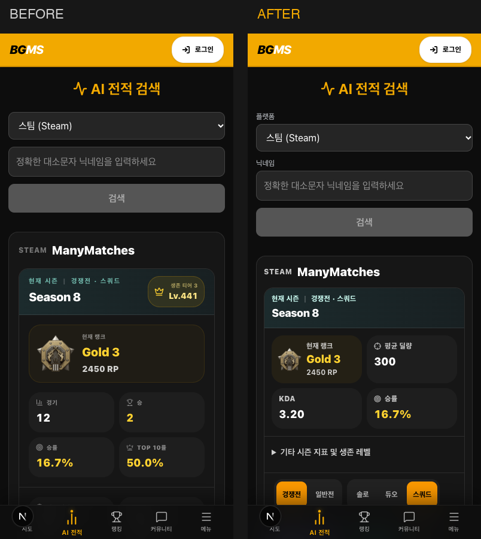
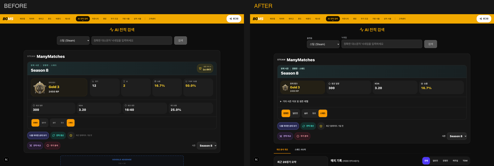

# PUBG 전적 검색 화면 구성과 비교 검증

2026-11-03 디자인 개선은 전적·점수 계산과 요청 계약을 유지하고 검색 조작, 정보 순서, 글자 가독성, 광고의 위치를 변경한다.

## 화면 구성

- 검색창은 플랫폼과 닉네임 레이블을 제공한다. 추천 목록은 combobox/listbox/option으로 연결하고 방향키·Enter 선택, Escape 닫기, 방향키로 다시 열기, Tab으로 벗어날 때 닫기와 IME 조합 중 검색 방지를 지원한다. 최근 검색·즐겨찾기 조작은 별도 영역에서 유지한다.
- 현재 시즌 카드에는 랭크(일반전은 경기 수)·평균 딜량·KDA·승률을 우선 표시한다. 경기 합계·승·Top 10률·평균 생존·헤드샷률·최고 랭크·생존 레벨은 기본 접힌 상세 영역에서 확인한다. 시즌·모드·파티 변경은 기존 콜백을 사용한다.
- 모바일에서는 최근 매치 다음에 최근 20경기 요약을 배치한다. 1024px 이상에서는 요약 320px 레일과 매치 목록을 나란히 표시한다.
- AI 분석 영역은 모바일과 PC 모두 프로필·전적 섹션 탭 다음, 최근 매치·요약 앞에 위치한다. 비로그인 상태에서는 안내를 접어 두며, 기존 분석 컴포넌트는 중복 마운트하지 않는다. 인증·AI 요청 정책은 기존 컴포넌트가 소유한다.
- AI 분석 영역 머리글은 열림 상태에 따라 "펼치기/접기"와 화살표 방향을 바꾼다. BGMS AI 전술 분석 가이드는 이 영역 안(분석 결과 아래)에 두어 설명을 분석 가까이 두고, 설명 글자는 14px 이상으로 표시한다.
- 추천 목록을 방향키로 이동하면 활성 항목을 목록 스크롤 안으로 가져온다. 최근 검색·즐겨찾기 버튼에서 Escape를 누르면 목록을 닫고 입력창으로 focus를 돌려준다. 결과 화면의 검색창은 다른 플레이어 검색용임을 placeholder로 안내한다.
- 현재 시즌 카드의 랭크 이름은 가장 긴 티어(Platinum 3)도 375px에서 잘리지 않도록 모바일 글자·아이콘 크기를 줄이고 줄바꿈을 허용한다.
- 경기를 펼치면 맨 위에 "이 판 결론"(`MatchVerdictBlock`)을 표시한다. 사망 경위, 경기 티어·점수, 전투·전술·생존 중 만점 대비 비율이 가장 높은 범주(50% 이상, "좋았던 점")와 가장 낮은 범주(50% 미만, "아쉬운 점")를 티어 근거 요약 문장과 함께 보여 준다. 선정은 `lib/pubg-analysis/matchVerdict.ts`이고 서버가 내려준 `benchmark.breakdown`만 쓴다. 기본 요약·TDM은 점수 줄을 숨기고, 근거가 "측정 불가"인 범주는 고르지 않으며, 한쪽만 있으면 한쪽만 표시한다.
- 펼친 경기의 "경기 흐름" 섹션은 미니맵(지도와 전체 이벤트 보기), AI 코칭·개인 성적·무기 기록·팀원 섹션과 함께 기본으로 접혀 있다. 교전 목록으로 모바일 카드가 길어지므로 보고 싶은 사람만 연다.
- AI 코칭 카드(`MatchAiCoachingCard`)는 문장에 서버가 검증한 장면 ID가 있으면 "경과 시각 + 사건" 칩(최소 높이 44px 버튼)을 붙인다. 칩을 누르면 경기 흐름과 미니맵을 열고 해당 타임라인 이벤트를 선택한 뒤 지도로 스크롤한다. 장면 필드가 없는 응답은 칩 없이 그린다.
- `stats-top` 광고 ID는 유지하되 결과 화면에서는 분석 결과 뒤에 한 번만 배치한다. 검색 초기 화면의 기존 광고 조건, 고정 creative 크기, provider, 예약 높이, 피드 5·6·15경기 삽입 조건, 수동 좌우 레일의 화면별 단일 구성을 유지한다.

## 전적 갱신의 시즌 자동 선택

- 시즌을 명시하지 않은 API 조회는 현재 시즌의 일반전 또는 경쟁전 중 한 모드라도 `roundsPlayed > 0`이면 현재 시즌을 유지한다. 일반전이 비었을 때 경쟁전을 확인하고, 두 모드가 모두 성공적으로 비어 있을 때만 이전 시즌을 찾는다. 조회 실패는 빈 기록으로 취급하지 않는다.
- 이전 시즌은 목록의 위치 대신 현재 시즌 ID와 숫자 순서로 비교해 최신순 최대 3개를 선택하며, 일반전·경쟁전에 같은 판수 기준을 적용한다. 선택한 시즌의 조회 결과는 본 통계 응답에서 재사용한다.
- 현재 시즌을 유지하는 일반 경로의 통계 호출은 기존처럼 일반전·경쟁전 각 1회다. 이전 시즌 탐색에서는 일반전이 빈 시즌의 경쟁전 확인이 추가되어 기존 대비 최대 3회 늘어난다(상류 재시도 제외).

## 검증

공통 정적 검증은 `npm run verify:core`, 전적 회귀는 `npm run verify:analysis`, 통합 단위는 `npm run test:unit`을 사용한다.

기존 전적 브라우저 하네스의 기능·응답 경합·광고·반응형 검증:

```sh
RUN_STATS_BROWSER_SMOKE=true npx vitest run tests/stats-browser-smoke.test.ts
```

동일 `ready`/`ManyMatches` fixture와 고정 QA clock으로 변경 전후를 캡처한다. 변경 전에 `before`를 실행하고, 변경 후 `after`를 실행한다. 두 실행 사이에 fixture·테스트 데이터·시간 조건을 바꾸지 않는다.

```sh
RUN_STATS_DESIGN_COMPARISON=true STATS_DESIGN_PHASE=before npx vitest run tests/stats-design-comparison.test.ts
RUN_STATS_DESIGN_COMPARISON=true STATS_DESIGN_PHASE=after npx vitest run tests/stats-design-comparison.test.ts
```

산출물은 `tmp/stats-design-comparison/{before,after}`의 첫 화면·전체 페이지 PNG와 `metrics.json`이다. 375×667, 390×844, 430×932, 1440×900, 1920×1080에서 초기 검색과 정상 결과를 확인한다. `after` 실행에는 추천 키보드 조작과 상세 지표 펼치기 회귀도 포함한다. 산출물에 실제 회원 데이터나 운영 비밀 값을 사용하지 않는다.

브라우저 뷰포트와 fixture 검증은 실제 iOS Safari·Android 기기, 실제 광고 노출과 실제 AI 호출 검증을 대체하지 않는다.

## 동일 데이터 전후 화면

왼쪽이 변경 전(`a33e4755`), 오른쪽이 변경 후다. `ManyMatches` fixture와 위의 고정 시간 조건에서 측정했으며 실서비스 이용자 통계가 아니다.

| 화면 크기 | 프로필 높이 | 첫 매치 위치(문서 상단 기준) |
| --- | --- | --- |
| 390×844 | 888 → 637px | 2138 → 1231px |
| 1440×900 | 608 → 533px | 1260 → 973px |

모바일 첫 매치까지의 거리가 약 42% 줄었다. 주요 지표를 먼저 보여주고, 나머지 지표는 펼쳐 확인할 수 있다.

모바일 이미지는 페이지 상단 1600px, 데스크톱은 상단 1200px을 같은 범위로 비교한다.




