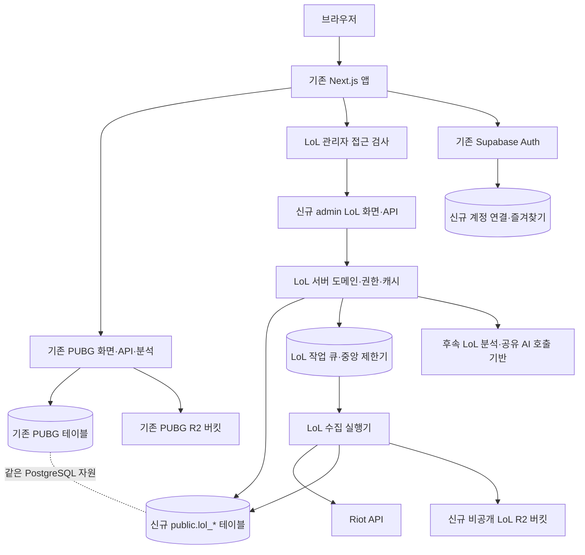
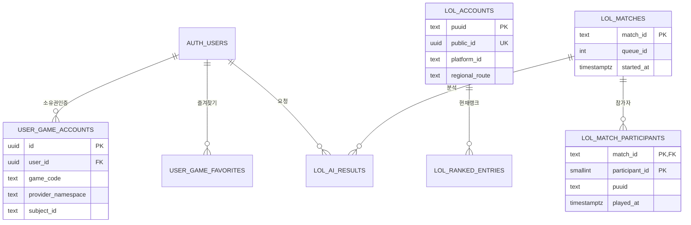
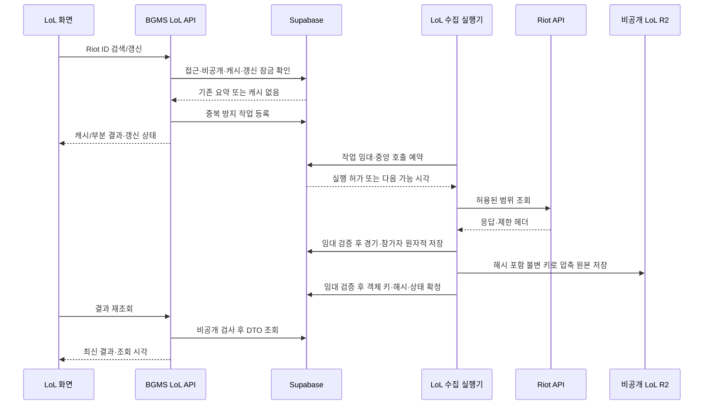
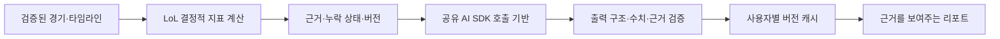

# BGMS 멀티게임 플랫폼 및 LoL 확장 설계

> **상태 (2026-10-22): `/admin/lol` 관리자 전용 검색과 영속 저장 기반 구현·로컬 검증됨.** 실제 Riot 검색 9개 요청은 별도 MVP 작업에서 모두 HTTP 200이었고, 이번 PostgreSQL 17.10 + PostgREST 16.5 격리 검증은 fixture 기반 검색→저장→새 프로세스 재조회/cache hit, 권한 경계, REST 장애 503, flag-off 복귀를 통과했다. 이는 전체 Supabase 스택이나 원격/운영 DB 검증이 아니다. 실제 관리자 로그인 세션, R2·AI·공개 LoL 경로는 미검증 또는 미구현이다. [영속 저장 계획](../plans/2026-10-22-lol-persistence-foundation.md)과 [개발 DB 검증](../plans/2026-10-22-lol-development-db-verification.md)을 본다.
> 과거 조사·검토 기준일: **2026-10-21**. 당시 본인 전용 경계는 코드·격리 검증 및 전체 최종 독립 검토를 통과했다(필수 수정 0건). 실제 Next HTTP는 익명 요청이 페이지에서 `/login`으로 307, 상태 API에서 401임을 확인했다. 실제 인증 사용자·RSC 개인 캐시·Preview 검증, 운영 활성화·배포·Git 커밋은 미실행이다.
> 최우선 조건: 기존 PUBG 서비스·데이터·로그인·전적 URL을 보호한다.

이 문서는 후속 에이전트가 대화 기록 없이 설계 배경과 구현 경계를 이해하기 위한 인계 문서다. 사용자에게 현재 있는 Riot 키는 **Development API Key**다. 비공개 개발에 사용하고, 공개 서비스는 Production 승인과 정책 확인을 선행한다. 키 값·회원 정보·운영 자격 증명은 문서에 포함하지 않는다.

**접근 설계 보완:** 개발 중에는 `/admin/lol/*`와 `/api/admin/lol/*`를 사용하며, **유효한 로그인 + 매 요청 현재 `profiles.role = admin`**을 요구한다. 모든 관리자를 허용하고 일반 회원·익명을 차단한다. 소유자 UUID 환경 설정·비교는 사용하지 않는다. `/lol/*`는 공개 승인 후의 목표 경로다. 12.1절의 관리자 전용 경계는 구현되어 단위·격리 브라우저 회귀가 통과했다. 실제 Next HTTP·인증된 Preview 응답은 검증하지 않았으며 운영 활성화는 수행하지 않았다. 이후 별도 작업에서 운영 DB에 LoL migration을 적용하고 persistence flag를 활성화한 기록이 [운영 영속 저장 적용 준비](../plans/2026-10-22-lol-production-persistence.md)에 있지만, 이 설계 문서를 읽는 시점의 실제 운영 활성화·배포 상태는 재확인이 필요하다.

- **확인됨:** 실제 저장소·운영 DB의 읽기 전용 조회·공식 문서로 확인한 조사 시점의 사실.
- **제안:** 앞으로 구현할 구조·수치·운영 기준. 현재 구현이나 Riot의 허가를 의미하지 않는다.
- **추가 검증 필요:** 권한·실측·승인 또는 최신 문서 재확인이 필요한 사항.

후속 작업자는 먼저 [AGENTS.md](../../AGENTS.md), [CLAUDE.md](../../CLAUDE.md), [프로젝트 지도](../project-map.md)를 읽고 `git status --short`를 확인한다. 구현 요청을 별도로 받은 다음 해당 단계만 수행한다. 조사 이후 코드·API·정책·가격이 달라졌다면 실제 상태를 우선하고 이 문서를 갱신한다. 여기 적힌 정리·삭제·배포 계획은 운영 실행 권한을 부여하지 않는다.

## 1. 핵심 요약

**제안 — 기존 저장소·Next.js 앱·Supabase Auth·DB를 유지하고, LoL을 독립 도메인으로 추가한다.**

| 영역 | 추천 결정 | 이유와 한계 |
| --- | --- | --- |
| 저장소·앱 | BGMS 저장소와 Next.js 프로젝트 유지 | 1인 운영의 배포·인증 중복을 줄인다. 배포 장애 범위는 공유하므로 PUBG 회귀 검증이 필수다. |
| 라우트 | 비공개 `/admin/lol/*`, `/api/admin/lol/*`; 공개 후 `/lol/*`, `/api/lol/*` | 현재 관리자 계정만 접근. 기존 `/stats/[platform]`의 Steam/Kakao 의미를 보존한다. |
| DB | 기존 DB의 `public.lol_*` 신규 테이블 | 기존 연결·Auth·마이그레이션 도구 활용. CPU·메모리·백업 자원은 공유한다. |
| 권한 | 수집 테이블은 서버 전용, 사용자 관계는 소유자 RLS | 기존 서버 전용 테이블 운영 방식과 맞춘다. RLS와 명시적 권한 회수를 함께 적용한다. |
| 원본 저장 | 같은 Cloudflare 계정의 **별도 비공개 LoL R2 버킷** | 기존 PUBG 재압축 작업의 넓은 처리 범위와 충돌을 피한다. |
| 수집 | 검색 기반 수집, 중앙 DB 제한기·잠금·작업 큐 | 전역 호출 제한·중복 제거를 보장한다. 전수 수집은 시작하지 않는다. |
| 초기 범위 | KR, 소환사의 협곡 솔로·자유랭크 | API·정책·통계 해석 범위를 좁힌다. |
| 인증 | BGMS 로그인 유지, Riot 소유권 연결은 RSO 승인 후 | 전적 검색·BGMS 로그인·Riot 계정 소유권은 별개다. |
| AI | 기본 전적 안정화 이후 | 정책·비용·데이터 품질 검증 우선. PUBG 엔진을 복제하지 않는다. |

**확인됨:** 현재 DB는 약 2,108MiB이며 PUBG 경기 인덱스 테이블 하나가 약 1,272MiB다. 서버 전용 DB 접근, 수집·R2·AI 운영 기반이 이미 있다. 초기부터 모노레포·마이크로서비스·별도 Supabase 프로젝트를 도입할 근거는 부족하다.

**추가 검증 필요:** CPU·연결·쿼리 지연 여유는 용량만으로 판단할 수 없다. Production 승인, 원본 보관 기간, AI 사업자에게 전달 가능한 데이터 범위도 공개 전 확정해야 한다.

## 2. 현행 구조 분석

### 2.1 조사 기준

**확인됨:** [GitHub 저장소](https://github.com/ka6865/BGMS)는 공개 저장소다. 로컬 조사 브랜치는 `ka6865/harness-skill-tracking`, HEAD는 `c3a1013b`였다. 원격 기본 브랜치의 당시 HEAD는 `01524e4a2d7976796db4bdf103feba08663cfc59`였다. 조사한 앱 구조는 일치하며, 로컬 작업 지침·스킬·검증 설정 등의 차이는 별도로 취급했다.

코드·워크플로·설정·설치 패키지를 읽고, 운영 DB는 짧은 읽기 전용 트랜잭션으로 카탈로그·통계만 조회했다. 회원 행이나 경기 원본은 추출하지 않았다. 공식 문서와 공개 사이트를 조회했지만 실제 Riot 전적 API·Gemini 호출, R2 전체 스캔, 운영 변경은 하지 않았다. 프런트엔드·운영과 백엔드·저장소 검토를 분담하고 보안 경계를 추가 검토했다.

### 2.2 버전·배포 환경

아래는 `package.json`의 버전 범위와 구분되는 **조사 환경의 설치 버전**이다.

| 항목 | 확인된 값 |
| --- | --- |
| Next.js / React | `16.3.8` / `19.3.0` |
| Tailwind CSS | `4.3.3` |
| Supabase JS / SSR | `2.117.2` / `0.12.7` |
| Vercel AI SDK / Google 공급자 | `6.0.300` / `3.0.130` |
| Vitest / Jest | `4.1.11` / `30.5.2` |
| 운영 PostgreSQL | `17.6` |
| Supabase 조직 요금제 / 리전 | Pro / `ap-northeast-2` |
| Vercel 프로젝트 / 런타임 | `pubg-map-app` / Node.js `24.x` |
| PR 검증 런타임 | Node.js `22` |

TypeScript 사용은 확인했으며 정확한 설치 버전은 구현 시작 시 잠금 파일과 재확인한다. [vercel.json](../../vercel.json)의 `git.deploymentEnabled`는 `false`다. PR을 만들면 자동 Preview가 생긴다고 가정하면 안 된다. 조사 당시 운영 배포는 준비 완료 상태였고 배포 보호 설정도 확인했다. 앱 자체의 비공개 LoL 접근 제어는 별도로 필요하다.

**제안:** CI·로컬·Vercel Node 버전을 맞추거나 차이를 검증한다. Next.js 구현은 설치 패키지의 `node_modules/next/dist/docs/`를 기준으로 한다.

### 2.3 화면·인증·SEO

| 실제 경로 | 확인된 동작 | 설계 제약 |
| --- | --- | --- |
| [app/page.tsx](../../app/page.tsx) | 기본 `/`는 `/maps/erangel`로 영구 이동. 기존 쿼리 처리도 존재 | 루트를 게임 선택 화면으로 바꾸지 않는다. 운영 `308` 응답도 확인했다. |
| [app/layout.tsx](../../app/layout.tsx) | AuthProvider, 공통 메뉴, 분석, PUBG 제목·OG·키워드 | LoL에서 상속되는 PUBG 메타데이터를 덮어쓴다. |
| [전적 페이지](../../app/stats/%5Bplatform%5D/%5Bnickname%5D/page.tsx), [statsPageModel.ts](../../lib/stats/statsPageModel.ts) | 플랫폼은 `steam`·`kakao` | 여기에 `lol`을 넣지 않는다. |
| [GlobalHeader.tsx](../../components/common/GlobalHeader.tsx) | PUBG 중심 헤더 | 작은 게임 전환 메뉴 추가 후보 |
| [BottomNav.tsx](../../components/common/BottomNav.tsx), [GlobalMobileMenu.tsx](../../components/common/GlobalMobileMenu.tsx) | 지도·전적·랭킹·게시판·메뉴 및 일부 화면 숨김 규칙 | PUBG 동작 보존, LoL 분기 추가 |
| [SidebarFooterWrapper.tsx](../../components/layout/SidebarFooterWrapper.tsx) | 지도 레이아웃 특례, 푸터, 광고 스크립트 제어 | 미승인·비공개 LoL 광고를 명시적으로 차단 |
| [StatsPageShell.tsx](../../components/stat/layout/StatsPageShell.tsx) | PUBG 전적 화면에 결합 | 강제 범용화하지 않음 |
| [proxy.ts](../../proxy.ts), [supabase-middleware.ts](../../lib/supabase-middleware.ts) | 세션 갱신·접근 경계 | 기존 로그인 쿠키 재사용 |
| [브라우저 클라이언트](../../utils/supabase/client.ts), [서버 클라이언트](../../utils/supabase/server.ts) | Supabase 세션 연결 | 사용자 인증 경로 재사용 |
| [guard.ts](../../utils/supabase/guard.ts)의 `withAuthGuard` | 토큰 또는 쿠키 검증. 실패한 Bearer를 임의로 쿠키 인증으로 대체하지 않음 | 연결·즐겨찾기·AI 인증에 활용 |
| [adminGuard.ts](../../lib/server/adminGuard.ts)의 `requireAdmin` | 인증 후 service role로 현재 `profiles.role` 검사. 관리자 전체를 허용 | LoL 접근 모듈은 개발 플래그 확인 후 이 가드를 매 요청 재사용. 기존 가드의 다른 호출부는 변경하지 않음 |
| [app/sitemap.ts](../../app/sitemap.ts), [app/robots.ts](../../app/robots.ts) | 기존 SEO 진입점 | 기존 사이트맵 보존, LoL 별도 추가 |

**확인됨:** 현재 `/admin` 페이지는 `updateSession()`의 경로 분기로 보호되지만 `/api/admin`은 그 분기에 포함되지 않는다. API는 개별 가드가 필요하다. 루트 `app/admin/layout.tsx`는 조사 시 존재하지 않았다. 공통 레이아웃만으로 LoL 페이지·API의 검사가 완료된다고 가정하지 않는다. 후속 확인 시 HEAD는 `5e553bf9`로 달라져 있었으므로 2.1절의 해시는 최초 조사 스냅샷이며 구현 시작 시 다시 기록한다.

### 2.4 PUBG 수집·R2·AI 경계

**확인됨:** [playerApiClient.ts](../../lib/pubg/playerApiClient.ts)의 `createPlayerApiClient`는 전체 25초·읽기 8초 등의 타임아웃, 취소·검증·제한된 재시도와 PUBG 호출 제한 추적을 포함한다. Riot에 그대로 적용할 근거는 없다. [responseCache.ts](../../lib/pubg/responseCache.ts)에 메모리·DB 캐시 도구가 있지만 주요 플레이어 흐름은 DB 직접 조회와 갱신 잠금도 사용한다. 전체 전적 흐름을 단순한 메모리→DB 캐시라고 설명하면 부정확하다.

[matchDiscovery.server.ts](../../lib/pubg/matchDiscovery.server.ts), [telemetryRegistry.server.ts](../../lib/pubg-analysis/telemetryRegistry.server.ts)는 PUBG 플랫폼·RPC·텔레메트리 계약에 묶여 있다. **제안:** 원칙만 참고하고 Riot 모듈은 별도로 둔다.

**확인됨:** [r2Service.ts](../../lib/pubg-analysis/r2Service.ts)는 S3 호환 접근·JSON 압축을 제공하지만 기존 버킷·도메인 계약과 결합되어 있다. 기존 객체가 모두 `pubg/` 아래에 있지는 않다.

- [cleanup_r2_orphan_analysis.ts](../../scripts/cleanup_r2_orphan_analysis.ts)는 루트 PUBG 분석 키를, [cleanup_r2_orphan_replay.ts](../../scripts/cleanup_r2_orphan_replay.ts)는 `telemetry-map/`을 대상으로 한다. 이들이 무조건 `lol/`을 삭제한다고 단정하지 않는다.
- [recompress_r2_json.ts](../../scripts/recompress_r2_json.ts)의 `isRecompressTarget`와 [r2-json-maintenance.yml](../../.github/workflows/r2-json-maintenance.yml)의 빈 기본 접두사는 공유 버킷의 새 JSON 객체까지 처리할 수 있다.
- [r2DeletionGuard.ts](../../lib/pubg-analysis/r2DeletionGuard.ts)는 일부 루트 접두사를 보호한다. `lol/backups/`가 자동 보호되는 것은 아니다.

따라서 초기에는 **별도 비공개 LoL 버킷**을 추천한다. 기존 PUBG 객체 이동이나 정리 범위 확장은 하지 않는다.

**확인됨:** AI는 `app/api/pubg/ai-analyze/route.ts`, `ai-summary/route.ts`, `ai-squad/route.ts` 및 `lib/pubg-analysis/`에 구현되어 있다. [constants.ts](../../lib/pubg-analysis/constants.ts)에 여러 Gemini 모델이 있다. [aiUsageTracker.ts](../../lib/pubg-analysis/aiUsageTracker.ts)의 `trackAiUsage`는 PUBG 분석 유형·플랫폼을 받으며 모델별 실제 요금 대신 고정 단가를 사용한다. LoL 비용 계산에 그대로 재사용하면 안 된다.

### 2.5 운영 DB 스냅샷

**확인됨 — 2026-10-21 읽기 전용 조회.** 행 수는 통계 추정이며 `COUNT(*)` 실측이 아니다. MiB는 1,048,576바이트다. 테이블 크기는 관련 인덱스를 포함한다.

| 객체 | 크기 또는 수량 | 추정 행 수 |
| --- | --- | ---: |
| 전체 DB | `2,210,802,835`바이트, 약 2,108MiB | — |
| `public` 기본 테이블 | 96개 | — |
| `pubg_player_matches` | `1,333,403,648`바이트, 약 1,272MiB | 1,706,584 |
| `pubg_player_cache` | `264,577,024`바이트, 약 252MiB | 224,142 |
| `processed_match_telemetry` | `224,215,040`바이트, 약 214MiB | 2,060 |
| `pubg_match_performance` | `100,147,200`바이트, 약 95.5MiB | 25,556 |
| `pubg_player_match_discovery` | `75,014,144`바이트 | 128,587 |

`bgms_private` 스키마와 `bgms_private.pubg_collection_requests`가 존재한다. 조사 당시 `lol` 스키마·`lol_*` 테이블·`user_game_accounts`는 없었다.

`profiles`에는 `pubg_nickname`, `pubg_platform` 등이 있다. `ai_usage_logs.platform`은 PUBG 플랫폼 문맥에서 사용된다. 여기에 `lol`을 기록해 게임·플랫폼 의미를 섞지 않는다. `ai_usage_logs`는 사용자·모델·토큰·비용·분석 유형·상태·오류·소요 시간·요청 식별자 등을 저장하며 사용자 FK는 삭제 시 NULL 처리된다.

**확인됨:** 조사한 PUBG 플레이어 서버 전용 테이블과 `ai_usage_logs`에는 RLS·일반 역할 권한 제한이 있다. `profiles`에는 열별 권한도 있으므로 테이블 단위 권한만 보고 전체 비공개라고 판단하지 않는다. 신규 `public` 객체는 기본 권한에 의존하지 말고 명시적으로 제한한다. [서버 전용 테이블 운영 문서](../operations/service-role-only-tables.md)를 따른다.

[supabase/config.toml](../../supabase/config.toml)의 로컬 노출 스키마는 `public`, `graphql_public`이다. **운영 Data API 노출 설정이 동일한지는 추가 검증 필요**하다.

## 3. 목표 아키텍처

다음 구조는 **제안**이다.



게임별 경계는 라우트·컴포넌트·서버 모듈·테이블·수집 큐·호출 제한·환경 변수·R2 버킷이다. 인증·디자인 기초·관측 도구는 재사용한다. 공통화는 실제 두 번째 사용처가 생기는 작은 단위에서 수행한다.

**대안 평가:** 모노레포는 빌드·패키지를 독립 운영할 때 유리하지만 현재 단일 앱에는 필요하지 않다. 마이크로서비스는 장시간 수집과 독립 장애 격리가 필요해졌을 때 검토한다. 별도 Supabase는 컴퓨트·복구를 분리하지만 인증 검증·사용자 참조·연결·마이그레이션 운영이 늘어난다. 초기에는 수집 예산과 기능 차단으로 공유 자원을 보호한다.

## 4. Git 및 폴더 구조

**유지:** `app/page.tsx`, `app/maps/`, `app/stats/`, `app/api/pubg/`, `app/api/internal/pubg/`, `lib/pubg/`, PUBG 분석·`StatsPageShell.tsx`의 계약. 기존 파일의 대규모 이동·폴더 이름 변경은 하지 않는다.

**신규 제안 — 비공개 개발 단계:** 아래 경로는 아직 존재하는 기능을 뜻하지 않는다. 폴더 목록 전체를 첫 PR에서 생성하지 않는다.

```text
app/
  admin/lol/
    layout.tsx
    page.tsx
    loading.tsx
    error.tsx
    summoners/[platform]/[publicId]/page.tsx
    matches/[matchId]/page.tsx
    champions/[championId]/page.tsx
  api/
    admin/lol/
      status/route.ts
      search/route.ts
      summoners/[publicId]/route.ts
      summoners/[publicId]/refresh/route.ts
      matches/[matchId]/route.ts
    internal/lol/jobs/route.ts
components/lol/
  LolSearch.tsx
  LolNavigation.tsx
  SummonerOverview.tsx
  RankedSummary.tsx
  MatchList.tsx
  MatchDetail.tsx
lib/lol/
  access.server.ts
  riotClient.server.ts
  routing.ts
  validation.ts
  repository.server.ts
  rateLimit.server.ts
  jobs.server.ts
  collection.server.ts
  r2.server.ts
  metrics.ts
  privacy.server.ts
  versions.ts
types/lol.ts
tests/lol-*.test.ts
tests/lol-dev-access.test.ts
tests/lol-dev-browser.test.ts
tests/fixtures/lol/
scripts/run_lol_jobs.ts
scripts/cleanup_lol_data.ts
.github/workflows/lol-collection.yml
.github/workflows/lol-maintenance.yml
supabase/migrations/<신규 시각>_lol_*.sql
```

공개 승인 후 별도 PR에서 `app/lol/*`, `app/api/lol/*`, `app/lol/sitemap.ts`를 추가한다. 초기에는 이 경로의 별칭·리다이렉트·공개 프록시를 만들지 않는다. `components/lol`과 `lib/lol`은 공개/비공개 경로와 분리하고, 공개 라우트의 권한·캐시 계약을 새로 검토한다. `app/api/internal/lol/jobs/route.ts`와 수집 워크플로는 큐 도입 이후에만 추가하며 첫 PR에는 없다.

`[platform]`은 **LoL 라우트 안에서만** `kr`, `euw1` 등 Riot 플랫폼이다. PUBG 타입을 공유하지 않는다. `[publicId]`는 BGMS가 생성한 공개 UUID이며 PUUID를 URL에 직접 넣지 않는다. UUID는 접근 권한이 아니므로 비공개 필터는 별도로 적용한다.

| 기존 파일 수정 후보 | 필요한 변경 | 시점 |
| --- | --- | --- |
| `components/common/GlobalHeader.tsx` | 공개 게임 전환 진입점 | 공개 승인 후 |
| `components/common/BottomNav.tsx`, `GlobalMobileMenu.tsx` | 공개 `/lol` 메뉴 분기, PUBG 동작 보존 | 공개 승인 후 |
| `components/layout/SidebarFooterWrapper.tsx` | 초기 `/admin/` 광고 제외 재사용·검증. 공개 LoL의 레이아웃·광고 허용 변경은 후속 | 비공개 검증, 공개 통합 시 필요 변경 |
| `app/robots.ts` | 공개 LoL 사이트맵 연결. 비공개 단계에는 추가하지 않음 | 공개 승인 후 |
| `app/layout.tsx` | 기존 상속으로 해결되지 않는 최소 변경 | 필요성이 입증될 때만 |
| `next.config.ts` | Data Dragon 이미지 호스트 설정 | 이미지 최적화에 필요할 때 |
| `scripts/verify_migrations_local.sh`, 관련 fixture | 신규 마이그레이션·권한·RPC 검사 등록 | DB |
| `scripts/backup_core_tables.ts` | 사용자 관계·비공개 통제 복구 대상 검토 | 영속 사용자 데이터 도입 |
| `docs/operations/service-role-only-tables.md` | 신규 서버 전용 계약 | DB |
| AI 추적기·관리자 집계 호출부 | 게임 차원·모델별 비용 계약 | AI |

**Git 제안:** 기존 main/develop 방식을 유지하고 작은 기능 브랜치·PR로 나눈다. 기존 변경을 보존한다. 기능 플래그가 꺼진 상태에서도 PUBG 검사 통과를 요구한다. 이번 문서 작업은 브랜치 생성·커밋·PR·배포를 포함하지 않는다.

## 5. 데이터베이스 설계

### 5.1 세 가지 저장 방식 비교

| 기준 | A. 기존 `public`의 `lol_*` | B. 기존 DB의 `lol` 스키마 | C. 별도 Supabase 프로젝트 |
| --- | --- | --- | --- |
| Auth·세션 | 그대로 사용 | 그대로 사용 | 기존 Auth 토큰 검증 연결 필요 |
| 사용자 FK·조인 | 같은 DB에서 가능 | 같은 DB에서 가능 | 프로젝트 간 FK 불가, 앱 조합 필요 |
| CPU·메모리·연결 | PUBG와 공유 | PUBG와 공유 | 분리 가능 |
| 경기 저장 용량 | 기존 디스크 공유 | 동일 | 별도 디스크·요금 |
| RLS·노출 | 접두사는 보안 경계가 아님. 권한 회수 필수 | 이름 공간은 명확하나 노출·GRANT 설정 필요 | 장애 범위 축소, 자격 증명 증가 |
| 백업·복구 | 프로젝트 복구 영향 공유 | 물리 복구 영향 동일 | 독립 복구 가능 |
| 마이그레이션 | 기존 파이프라인 활용 | 스키마·함수 경로 관리 추가 | 파이프라인·적용 순서 추가 |
| 비용·운영 | 가장 낮음 | 비용 유사, 설정 증가 | 추가 컴퓨트·운영 부담 |
| 향후 게임 | 게임별 접두사 | 게임별 스키마 | 프로젝트 수 증가 가능 |
| 장애 범위 | 앱·DB 공유 | 앱·DB 공유 | DB 분리, 같은 앱이면 배포 장애 공유 |
| 독립 서비스 이전 | 도메인·저장 계약 분리로 준비 | 논리적 추출이 편리 | 가장 쉬우나 초기 비용 큼 |

**제안:** A를 선택한다. 기존 서버 전용 접근 패턴에 맞고 Data API 설정 변경을 줄인다. B도 대안이지만 자원 격리가 되지 않는다. 별도 스키마를 Supabase JS로 접근하려면 노출 설정 또는 제한된 RPC/직접 연결을 설계해야 한다. service role이 노출되지 않은 스키마에 자동 접근하는 것은 아니다. [공식 사용자 스키마 안내](https://supabase.com/docs/guides/api/using-custom-schemas)

### 5.2 공통 저장·보안 계약

이 절의 테이블·열·TTL은 모두 **신규 설계 제안**이다. TTL은 Riot이 허용한 보관 기간이라는 뜻이 아니다. 정책 검증 결과가 더 짧으면 그 값을 우선한다.

> **현재 구현 상태(2026-10-23):** 실제 migration(`supabase/migrations/20261022114157_lol_persistence_foundation.sql`)은 아래 제안 전체가 아니라 `lol_accounts`, `lol_ranked_entries`, `lol_matches`, `lol_match_participants` 4개 핵심 테이블과 검색/상세 DTO cache·rate-limit·collection lease 상태 3개를 더한 7개 테이블만 만든다. `lol_jobs`, `lol_service_state`, `lol_privacy_controls`, `lol_ai_results`, `user_game_accounts`, `user_game_favorites`는 아직 없다. TTL도 이 절의 제안(이름 24시간·프로필 1시간·랭크 5분·요약/참가자/원본 30일)과 다르게, 검색 DTO 2분·경기/참가자/원문 최대 7일로 구현됐다. R2 원본 저장 열 대신 DB `request_json`에 원문을 둔다. 자세한 현재 계약은 [영속 저장 기반](../plans/2026-10-22-lol-persistence-foundation.md), [운영 적용 준비](../plans/2026-10-22-lol-production-persistence.md)를 본다. 아래 제안 객체는 구현 완료로 바꾸지 않았다.

- 시간은 `timestamptz`, 기간은 초, 크기는 바이트. 경기 시각은 API 단위를 확인해 변환한다.
- PUUID는 제품·환경의 자격 증명 문맥에서 취급한다. 개발용 데이터와 운영 데이터를 섞지 않고 Development→Production 식별자 호환성을 검증한다.
- `platform_id`와 `regional_route`를 분리한다. `kr`와 `asia`는 대체할 수 없다. 허용값은 Riot 라우팅 모듈과 DB 계약을 맞춘다.
- 수집 테이블은 RLS를 켜고 `anon`, `authenticated` 권한을 명시적으로 회수한다. 브라우저는 BGMS API의 검증된 DTO만 받는다.
- 신규 함수의 기본 `PUBLIC EXECUTE`도 회수한다. 서버 역할만 허용하고 가능하면 호출자 권한 함수를 쓴다. 권한 상승 함수는 고정 `search_path`·완전 수식 객체명·실행 역할 제한을 검증한다.
- 기존 [createServiceRoleSupabase](../../lib/server/serviceRoleSupabase.server.ts)를 참고하되 새 서버 모듈은 서버 전용 경계를 명확히 둔다. service role은 RLS를 우회하므로 API의 인증·비공개 검사·행 선택을 대체하지 않는다.
- 삭제는 DB·캐시·작업·R2·AI·로그·백업 복구까지 연결한다. 계정 연결 해제와 공개 전적 삭제는 다른 요청이다.
- 기존 PUBG·회원 데이터는 변경·삭제·이관하지 않는다. 모든 DB 변경은 신규 마이그레이션으로 계획한다.

근거: [Supabase API 보안](https://supabase.com/docs/guides/api/securing-your-api).

### 5.3 관계도



참가자 PUUID에는 `lol_accounts` FK를 걸지 않는다. 상대 9명의 프로필까지 생성·수집할 필요가 없기 때문이다. 통합 계정의 `subject_id`에도 여러 게임 테이블을 가리키는 가짜 FK를 만들지 않는다. 서버가 공급자별 식별자를 검증한다.

### 5.4 핵심 전적 테이블

#### `lol_accounts`

- 역할·열: `puuid text PK`, `public_id uuid UNIQUE NOT NULL`, `game_name text`, `tag_line text`, `platform_id text NOT NULL`, `regional_route text NOT NULL`, `profile_icon_id integer`, `summoner_level bigint`, `account_fetched_at timestamptz`, `profile_fetched_at timestamptz`, `ranked_checked_at timestamptz`, `last_accessed_at timestamptz NOT NULL`.
- 제약·인덱스: 공개 UUID는 서버 생성. `(game_name, tag_line)` 조회 인덱스와 `last_accessed_at` 정리 인덱스. 이름 변경·재사용 때문에 Riot ID에 영구 소유권을 뜻하는 UNIQUE를 걸지 않는다. 문자열 정규화는 API 계약 검증 후 확정한다.
- 증가량: 검색된 고유 계정당 1행. 모든 경기 참가자의 계정을 자동 생성하지 않는다.
- TTL·보관: 이름 매핑 24시간, 프로필 1시간. 연결·즐겨찾기가 없고 90일간 사용하지 않은 계정은 삭제 후보. 필요한 재노출 방지 자료는 별도 통제로 관리한다.
- 보안: 서버 전용. PUUID·전체 조회 이력을 브라우저에 반환하지 않는다. 이름 변경에도 PUUID와 공개 UUID를 유지한다.

#### `lol_ranked_entries`

- 열: `puuid text FK -> lol_accounts.puuid ON DELETE CASCADE`, `platform_id text`, `queue_type text`, `tier text`, `rank text`, `league_points integer`, `wins integer`, `losses integer`, `fetched_at timestamptz`.
- PK: `(puuid, platform_id, queue_type)`. 초기 큐는 솔로·자유랭크만. API 계약에 맞는 수치 검증을 적용한다.
- 증가량·인덱스: 계정당 현재 플랫폼 최대 2행. PK 외 광범위 랭킹 인덱스는 만들지 않는다.
- TTL·삭제: 5분. 성공한 빈 응답은 `ranked_checked_at`과 함께 언랭크로 반영한다. 호출 실패를 언랭크로 덮어쓰지 않는다. 이전 플랫폼 랭크를 현재 랭크로 표시하지 않는다.
- 보안: 서버 전용. 초기에는 랭크 이력을 무제한 적재하지 않는다.

#### `lol_matches`

- 열: `match_id text PK`, `platform_id text`, `regional_route text`, `queue_id integer`, `map_id integer`, `game_version text`, `started_at timestamptz`, `duration_seconds integer`, `teams jsonb`, `data_version integer`, `summary_version integer`, `fetched_at timestamptz`.
- 원본 상태: `raw_object_key text`, `raw_status text`, `raw_sha256 text`, `raw_size_bytes bigint`, `raw_expires_at timestamptz`. 타임라인은 `timeline_object_key`, `timeline_status`, `timeline_sha256`, `timeline_size_bytes`, `timeline_expires_at`을 대응 자료형으로 둔다.
- 제약: 상태를 `pending`, `ready`, `failed`, `expired` 등 명시한 집합으로 제한. `teams`는 작은 요약이며 원본 전체를 넣지 않는다. 경기 ID·라우팅·응답 메타데이터 일치를 검사한다.
- 인덱스: `started_at`, 미완료 원본 복구용 부분 인덱스. 추가 인덱스는 실제 실행계획으로 결정한다.
- 증가량·보관: 고유 경기당 1행. 요약 30일, 경기 원본 30일, 타임라인 7일 제안. 정책 확인 전 무기한 저장하지 않는다.
- 보안: 서버 전용. 완료 경기는 정상 조회마다 재호출하지 않고 버전 변경·비공개·정합성 복구 때만 재처리한다.

#### `lol_match_participants`

- 열: `match_id text FK -> lol_matches.match_id ON DELETE CASCADE`, `participant_id smallint`, `puuid text NULL`, `team_id smallint`, `champion_id integer`, `team_position text`, `win boolean`, `kills integer`, `deaths integer`, `assists integer`, `cs integer`, `neutral_minions_killed integer`, `gold_earned integer`, `damage_to_champions integer`, `vision_score integer`, `wards_placed integer`, `wards_killed integer`, `damage_to_objectives integer`, `items integer[]`, `perks jsonb`, `played_at timestamptz`, `queue_id integer`.
- PK: `(match_id, participant_id)`. 유효한 PUUID가 있을 때만 `(match_id, puuid)` 부분 UNIQUE. 봇·삭제·누락을 위해 PUUID NULL 허용.
- 인덱스: PUUID 존재 조건의 `(puuid, played_at DESC, match_id DESC)`. 커서 페이지네이션 사용. 모든 지표 열에 인덱스를 만들지 않는다.
- 계약: `cs`는 라인 미니언 수, 총 CS는 정글 미니언을 합산한다. `played_at`, `queue_id`는 조회용 중복 열이며 경기 요약과 같은 트랜잭션에 쓴다. 누락 지표를 무조건 0으로 바꾸지 않는다.
- 증가량·보관: 정상 5대5 경기당 10행, 부모와 함께 30일. 10명 가정을 다른 모드에 확장하지 않는다.
- 보안: 서버 전용. 외부 응답 전에 참가자 비공개 통제를 적용한다.

### 5.5 사용자 관계 테이블

#### `user_game_accounts` — 소유권 인증

- 열: `id uuid PK`, `user_id uuid FK -> auth.users.id ON DELETE CASCADE`, `game_code text`, `provider text`, `provider_namespace text`, `subject_id text`, `verification_method text`, `verified_at timestamptz`, `created_at timestamptz`.
- 제약·인덱스: `(provider_namespace, game_code, subject_id)` UNIQUE, `user_id` 인덱스. 한 사용자는 여러 계정을 연결할 수 있지만 동일 검증 계정의 동시 소유자는 한 명으로 제한한다.
- 보관·증가량: 인증 연결당 1행. 해제·회원 삭제 시 삭제. 공급자 토큰은 기본적으로 저장하지 않는다. 토큰 유지가 필요한 기능은 별도 보관 설계가 필요하다.
- RLS: 자기 행 SELECT만 허용. 쓰기는 인증된 서버 경로에서 수행한다. 클라이언트의 PUUID를 소유권 증거로 인정하지 않는다.
- 조건: Riot은 RSO로 검증한 경우에만 `verified_at` 기록. 기존 `profiles` 컬럼은 유지하고 자동 이관하지 않는다.

#### `user_game_favorites` — 즐겨찾기

- 열·PK: `user_id uuid FK -> auth.users.id ON DELETE CASCADE`, `game_code text`, `provider_namespace text`, `subject_id text`, `created_at timestamptz`; 앞 네 열이 복합 PK다.
- 여러 사용자가 같은 계정을 즐겨찾기할 수 있다. 소유권 인증과 무관하다.
- 자기 행 SELECT RLS, 쓰기는 서버에서 계정 유효성·개수 제한을 검사한다. 제거·탈퇴 시 삭제한다. 초기 검색 기록은 브라우저의 제한된 최근 목록으로 시작하고 무제한 서버 이력 테이블은 만들지 않는다.

### 5.6 캐시·작업·운영·비공개 테이블

| 신규 테이블 | 주요 열·키·인덱스 | 보관·증가량·접근 |
| --- | --- | --- |
| `lol_api_cache` | `cache_key text PK`, `kind text`, `payload jsonb`, `http_status integer`, `expires_at timestamptz`; 만료 인덱스 | 작은 매핑·경기 목록·404만 저장. 유형별 TTL, 키·본문·총량 제한. 서버 전용 |
| `lol_jobs` | `id uuid PK`, `dedupe_key text UNIQUE`, `kind text`, `payload jsonb`, `status text`, `attempts integer`, `run_after timestamptz`, `lease_token uuid`, `lease_until timestamptz`, `last_error_code text`, `created_at/updated_at timestamptz`; 대기 상태 `(run_after,id)` 부분 인덱스 | 대상·작업별 최대 1개 활성 항목. 완료 7일, 최종 실패 30일. payload 크기 제한, 키·원본 금지. 서버 전용 |
| `lol_rate_limit_state` | 복합 PK `(credential_ref,host,scope,method,window_seconds)`; 문자열 `text`, 창 `integer`; `limit_value integer`, `next_permit_at/blocked_until/updated_at timestamptz`; 일일 예산용 `window_start timestamptz`, `used_count bigint` | 키 값 대신 비밀 아닌 별칭. 앱·메서드·서비스·일일 예산 상태. 활성 제한 창보다 오래 보존 후 정리. 고정된 소수 행, 서버 전용 |
| `lol_service_state` | `id smallint PK`와 단일 행 CHECK, `public_enabled boolean`, `collection_enabled boolean`, `daily_call_budget integer`, `updated_at timestamptz` | 초기 두 플래그 false. 중단·호출 상한. 비밀 값 없음. 서버 전용, TTL 없음 |
| `lol_privacy_controls` | `subject_hash text PK`, `action text`, `received_at/completed_at timestamptz`, `policy_version text` | 단순 PUUID 해시 대신 환경별 비밀을 사용하는 HMAC. 재노출 방지 최소 기록. 보관 근거·기간은 정책 확인 필요. 서버 전용 |
| `lol_ai_results` — 후속 | `cache_key text PK`, `user_id uuid FK -> auth.users.id ON DELETE CASCADE`, `match_id text FK -> lol_matches.match_id ON DELETE CASCADE`, `target_puuid text`, `metric_version/prompt_version/model_policy_version text`, `evidence_hash text`, `locale text`, `result jsonb`, `created_at/expires_at timestamptz`; 사용자·생성일 및 만료 인덱스 | 캐시 키에 요청 사용자·대상·경기·버전·근거 포함. 최대 30일 제안, 근거/회원 삭제 시 무효화. 서버 전용, 인증 API로 자기 결과만 반환 |

작업 중복 키는 종류·대상·버전을 포함한다. 완료 작업 보관 중 다시 갱신하려면 원자적 재대기 전환과 영속 데이터 상태 확인을 수행한다. 작업 행이 삭제된 후에도 경기 PK가 중복 저장을 막는다.

`lol_service_state`는 기존 `system_settings`를 변경하지 않는다. **확인됨:** `app/api/admin/settings/route.ts`는 일부 예외를 제외한 설정을 공개 GET에 노출하고 쓰기 항목도 제한한다. Riot 비밀키나 민감한 값을 여기에 추가하면 안 된다.

### 5.7 마이그레이션·보관·복구

**제안:** 핵심 테이블, 제한기/큐 RPC, 사용자 관계, AI를 별도 신규 마이그레이션으로 나눈다. 기존 대형 PUBG 테이블의 인덱스 재작성·백필을 끼워 넣지 않는다. 실제 실행계획·정리 비용을 측정하기 전에 월별 파티션을 강제하지 않는다.

**확인됨:** [verify_migrations_local.sh](../../scripts/verify_migrations_local.sh)는 명시적 마이그레이션 목록·준비 fixture를 사용한다. 새 파일이 자동 검증된다고 가정하지 않는다. 전체 이력 재생의 기준선도 확인한다. 운영 `db push`로 일괄 적용하지 않는다.

[backup_core_tables.ts](../../scripts/backup_core_tables.ts)의 대상·키 목록에는 향후 사용자 관계·비공개 통제 복구를 명시적으로 반영한다. 대량 원본을 영구 백업 대상으로 자동 포함하지 않는다. 백업 보관·삭제 요청 처리와 복구 후 비공개 재적용을 정한다. 행 삭제와 물리 디스크 반환은 다르므로 용량 회수를 즉시 기대하지 않는다.

## 6. Riot API 설계

### 6.1 Development 키와 공개 조건

**확인됨:** Development 키만 있어도 개발은 가능하지만 공개 서비스 권한을 받은 상태는 아니다.

| 키·인증 | 공식 문서의 용도 | 적용 |
| --- | --- | --- |
| Development | 개발·실험용, 24시간마다 만료 | 로컬/접근 제한 환경 소량 검증. 만료 시 수집 중지·캐시 표시 |
| Personal | 개인·작은 비공개 공동체. 공개 알파·베타용 아님 | 공개 승인 우회 수단으로 사용하지 않음 |
| Production | 공개 제품용, 등록·검토·승인 필요 | 공개 LoL 출시 선행 조건 |
| RSO | Production 보유 및 별도 연동 절차 | Riot 소유권 인증 단계에서 도입 |

Personal 기본 제한은 초당 20회·2분당 100회, Production 문서상 시작 제한은 10초당 500회·10분당 30,000회다. Development를 포함한 **실제 값은 해당 키의 포털 할당량·응답 헤더로 재확인**하고 영구 상수로 가정하지 않는다. [Riot 포털 문서](https://developer.riotgames.com/docs/portal)

Production 신청에는 제품 설명·접근 가능한 비공개 데모·BGMS URL·사용 API·예상 호출량·캐시·삭제/비공개 절차·수익화·약관/개인정보 처리·필수 고지·RSO/AI 계획을 준비한다. 등록 상태·변경 신고 의무를 확인하고 광고는 정책상 승인/등록·무료 이용 조건을 충족한 뒤 켠다. [일반 정책](https://developer.riotgames.com/policies/general)

### 6.2 엔드포인트·식별자·범위

[공식 API 목록](https://developer.riotgames.com/apis)과 상세 명세에서 확인한 조사 시점 계약이다. 구현 시 재확인한다. `X-Riot-Token`은 서버에서만 전달한다.

| API | 대표 엔드포인트 | 입력·라우팅 | 범위·주의 |
| --- | --- | --- | --- |
| Account-V1 | `/riot/account/v1/accounts/by-riot-id/{gameName}/{tagLine}` | Riot ID, 계정 지역 | PUUID·현재 Riot ID. 각 경로 세그먼트 인코딩 |
| Account-V1 | `/riot/account/v1/accounts/by-puuid/{puuid}` | PUUID, 계정 지역 | 이름 변경 확인 |
| Account-V1 | `/riot/account/v1/region/by-game/{game}/by-puuid/{puuid}` | `game=lol` 또는 `tft` | 활성 지역 확인·선택 서버 검증 |
| Summoner-V4 | `/lol/summoner/v4/summoners/by-puuid/{encryptedPUUID}` | PUUID, 플랫폼 | 아이콘·레벨·수정 시각. 과거 Summoner ID 의존 금지 |
| League-V4 | `/lol/league/v4/entries/by-puuid/{encryptedPUUID}` | PUUID, 플랫폼 | 큐별 티어·단계·LP·승패. 현재 `by-puuid` 계약 사용 |
| Match-V5 | `/lol/match/v5/matches/by-puuid/{puuid}/ids` | PUUID, 경기 지역 | ID 목록, 위치·개수·시간·큐·종류 필터 |
| Match-V5 | `/lol/match/v5/matches/{matchId}` | 경기 ID, 경기 지역 | 참가자·팀·아이템·경기 통계 |
| Match-V5 | `/lol/match/v5/matches/{matchId}/timeline` | 경기 ID, 경기 지역 | 프레임·이벤트, 별도 호출. 최초 조회 필수 아님 |
| Champion Mastery-V4 | `/lol/champion-mastery/v4/champion-masteries/by-puuid/{encryptedPUUID}` | PUUID, 플랫폼 | 숙련도와 top/개별 챔피언/총점 계열. 승률 API 아님 |
| Spectator-V5 | `/lol/spectator/v5/active-games/by-summoner/{encryptedPUUID}` | **경로명과 달리 PUUID**, 플랫폼 | 진행 중 경기. MVP 제외, 정책 검토 후 추가 |
| Data Dragon | 버전 목록·챔피언/아이템/룬 JSON·이미지 | 버전·언어, 키 불필요 | 정적 자산. 실제 서버 패치와 배포 시점 차이 가능 |
| RSO | `/riot/account/v1/accounts/me` | RSO Bearer, 해당 계정 지역 | 로그인한 Riot 계정 확인. 일반 검색에는 불필요 |

상세 근거: [Account](https://developer.riotgames.com/api-details/account-v1), [Summoner](https://developer.riotgames.com/api-details/summoner-v4), [League](https://developer.riotgames.com/api-details/league-v4), [Match](https://developer.riotgames.com/api-details/match-v5), [Mastery](https://developer.riotgames.com/api-details/champion-mastery-v4), [Spectator](https://developer.riotgames.com/api-details/spectator-v5). 일부 상세 문서는 자바스크립트로 표시된다.

Match ID 목록 `count`는 기본 20, 허용 0~100이며 `startTime`, `endTime`은 epoch **초**다. 모든 과거 경기가 무기한 조회된다는 보장은 확인하지 못했다. 표본 기간·경기 수를 UI에 표시한다.

### 6.3 지역 라우팅

| Riot 플랫폼 | Match-V5 지역 |
| --- | --- |
| `kr`, `jp1` | `asia` |
| `na1`, `br1`, `la1`, `la2` | `americas` |
| `eun1`, `euw1`, `me1`, `tr1`, `ru` | `europe` |
| `oc1`, `sg2`, `tw2`, `vn2` | `sea` |

**확인됨:** Account-V1 지역 호스트는 `americas`, `asia`, `europe`이며 Match-V5의 `sea`를 그대로 적용하지 않는다. API별 라우팅 표를 나눈다. 오래된 개요와 충돌하면 현재 엔드포인트 명세를 검증한다. **제안:** 초기 KR는 계정 `asia`, 플랫폼 `kr`, 경기 `asia`만 지원한다.

**추가 검증 필요:** 개발→Production 암호화 식별자 호환성. Riot 안내는 API 키 보유 주체별 암호화 문맥을 설명하므로 다른 제품의 PUUID를 합치지 않는다. 키 갱신마다 반드시 바뀐다고 단정하지도 않는다. [Riot 식별자 안내](https://www.riotgames.com/zh-cn/DevRel/player-universally-unique-identifiers-and-a-new-security-layer)

### 6.4 검색·호출 흐름

1. Riot ID 길이·형식·선택 플랫폼·요청 빈도를 검증하고 `gameName#tagLine`을 각 필드로 분리·인코딩한다.
2. 이름 캐시가 없으면 Account로 PUUID를 얻는다. 초기 또는 서버 검증 시 활성 지역을 확인한다.
3. 비공개 통제 검사 후 프로필·랭크·경기 ID를 각각 TTL에 따라 갱신한다.
4. ID 20개 중 DB에 없는 경기만 수집한다. 첫 5개부터 표시하고 나머지는 큐로 처리한다. 상대마다 Account API를 호출하지 않는다.
5. 상세는 DB 요약 우선. 타임라인·숙련도는 해당 기능을 열 때 수집한다.
6. 챔피언 통계는 보유한 사용자 표본에서 계산하고 기간·모드·경기 수를 표시한다. 전체 시즌/전체 사용자 통계로 표현하지 않는다.

**제안·호출량:** 완전 미캐시는 계정 1 + 지역 1 + 프로필 1 + 랭크 1 + 목록 1 + 신규 경기 N = `5 + N`회다. 20경기면 25회, 타임라인 20개도 즉시 수집하면 45회다. 유효한 지역 캐시가 있으면 1회 감소한다. 숙련도 등은 별도다.

### 6.5 중앙 제한·오류 처리

**확인됨:** 앱별·메서드별·서비스별 제한이 있다. 앱/메서드는 키·지역 문맥, 서비스는 같은 서비스·지역의 여러 앱 영향을 받을 수 있다. 429는 `Retry-After`를 따라야 하고 하위 서비스 제한은 유형 헤더가 없을 수 있다. [공식 제한 설명](https://developer.riotgames.com/docs/portal)

**제안:** 인스턴스 메모리는 보조 캐시로만 쓰고 `lol_rate_limit_state`와 제한된 서버 RPC로 중앙 제어한다.

- DB 시간 기준으로 앱·메서드·서비스·일일 예산 행을 일정한 순서로 잠그고 **모든 제한을 함께** 예약한다. 하나라도 불가하면 일부만 소비하지 않고 다음 가능 시각을 반환한다.
- 초기 할당량의 80%를 상한으로 버스트 없는 보수적 간격 제어를 사용한다. 여러 창의 최대 대기 시간을 적용해 고정 창 경계의 두 배 호출을 피한다. 모의 시계로 검증한다.
- `X-App-Rate-Limit`, `X-App-Rate-Limit-Count`, `X-Method-Rate-Limit`, `X-Method-Rate-Limit-Count`를 관측한다. 순서가 뒤바뀐 응답이 최근 상태를 과거로 되돌리지 못하게 한다.
- 429 범위가 명확하면 그 범위를, 불명확하면 호스트를 보수적으로 막는다. `blocked_until`을 기존보다 앞당기지 않는다.
- 네트워크 오류도 예약 호출은 소비로 본다. DB 예약 실패·커밋 결과 불명확 시 Riot 호출을 하지 않는다. PUBG는 이 제한기에 의존하지 않는다.
- 네트워크 요청 동안 SQL 트랜잭션을 유지하지 않는다. 긴 대기는 `run_after`로 큐에 반환하고 서버리스에서 잠들어 기다리지 않는다.
- 타임아웃·5xx는 제한된 지수 백오프·지터. 400/403 무한 재시도 금지. 401/403 반복은 키·권한·지역을 진단하고 수집 중지한다.
- 404만 짧은 음성 캐시로 처리한다. 429·5xx를 계정 없음으로 저장하지 않는다. 로그에는 제한된 코드·요청 ID만 남기고 키·개인정보 URL·원본 본문을 제거한다.
- Riot 호스트는 서버 허용 목록으로 선택한다. 클라이언트 URL을 그대로 호출하는 범용 프록시를 만들지 않는다.

BGMS API에도 사용자/IP별 제한과 검색 작업 상한을 둔다. Riot 제한만으로 DB·큐 폭주를 막을 수는 없다.

### 6.6 공개·보관·AI 정책

| 내용 | 판단·적용 |
| --- | --- |
| 일반 LoL 검색 | RSO 없이 가능. 다른 게임에 일반화하지 않음 |
| 사용자 지정 경기 | 공개 표시·동의/RSO 제한이 있으므로 MVP 수집·노출 제외 |
| 숨긴 참가자 식별·부당한 실시간 우위 | 제공하지 않음. Spectator도 기능별 검토 |
| 대체 MMR/ELO·공식 랭크 대체 점수 | 만들지 않음. PUBG 점수 복사 금지 |
| Arena 통계 | 증강/아이템 승률 등 별도 금지 조건이 있어 초기 제외 |
| 원본 보관 | 보편적인 고정 일수 허용을 확인하지 못함. 30일/7일은 비용상 제안이며 승인 과정 확인 필요 |
| 삭제·비공개 | 접수·권한 확인·즉시 숨김·원본/파생 삭제·재수집 억제. 법적 보관 근거는 별도 확인 |
| 계약 종료 | 이용 중단·게임 정보 삭제 의무를 절차에 반영 |
| AI | 훈련/자기 통계 예시가 모든 생성형 AI·외부 전송 허가는 아님. 명시 확인 전 보류 |
| TFT·발로란트 | 게임별 정책 재검토. 발로란트 opt-in을 LoL과 혼동하지 않음 |

근거: [LoL 문서·정책](https://developer.riotgames.com/docs/lol), [일반 정책](https://developer.riotgames.com/policies/general), [API 약관](https://developer.riotgames.com/terms), [발로란트 문서](https://developer.riotgames.com/docs/valorant). 문서에 없는 허용 기간·승인 가능성을 추정해 확정하지 않는다.

## 7. 수집·캐시·DB·R2 데이터 흐름

### 7.1 조회·수집 시퀀스



작은 검색 단계는 허용된 시간 예산 내 처리하고 지속 수집은 내구성 있는 큐에 남긴다. 응답 후 임의의 미대기 Promise가 계속 실행된다고 가정하지 않는다. GitHub Actions 예약 작업은 회복·잔여 큐 처리용이며 사용자 응답의 즉시성을 보장하지 않는다.

### 7.2 캐시·중복·복구

| 항목 | 초기 TTL/동작 제안 |
| --- | --- |
| Riot ID → PUUID | 24시간, 이름 변경·충돌 시 재확인 |
| 프로필 / 랭크 / 경기 ID 목록 | 1시간 / 5분 / 2분 |
| 수동 갱신 | 동일 계정 최소 60초 및 전역 예산 |
| 계정/경기 404 | 1분 |
| 챔피언 숙련도 | 6시간, 선택 기능 |
| 완료 경기 | 정상 조회 시 재호출 없음. 보관·버전·비공개 우선 |
| 장애 시 | 허용된 캐시·마지막 성공 시각 표시. 삭제/비공개는 오래된 캐시로도 제공 금지 |

작업 가져오기는 짧은 `FOR UPDATE SKIP LOCKED` 트랜잭션을 제안한다. 임대마다 새 `lease_token`을 발급하고 저장·완료·재시도·연장 모두 토큰과 유효 기간을 검사한다. 오래된 작업자가 새 결과를 덮어쓰지 못하게 한다. 경기 ID·작업 중복 키·참가자 PK가 재실행의 멱등성을 보장한다.

### 7.3 R2 저장 계약

**제안:** 같은 Cloudflare 계정의 비공개 LoL 버킷·버킷 범위 자격 증명을 사용한다.

```text
lol/matches/{regionalRoute}/{matchId}/{dataVersion}-{sha256}.json.gz
lol/timelines/{regionalRoute}/{matchId}/{dataVersion}-{sha256}.json.gz
```

- gzip JSON 저장. 허가된 소량 표본으로 크기·압축률을 측정한다. 경기 ID·버전·해시로 중복과 불변 객체를 관리한다.
- DB에 키·해시·크기·만료·상태 기록. 경기/참가자는 같은 트랜잭션, R2는 별도 단계다.
- R2 실패 시 요약 제공, 원본 분석 보류. 재시도에 Riot 재조회가 필요할 수 있으므로 횟수·예산을 제한한다.
- R2 성공 후 DB 확정 실패는 조정 작업으로 복구한다. 참조 없는 객체는 임대·유예 기간 후 재참조 검사하고 정리한다.
- 오래된 작업자는 불변 객체 키·DB 확정 토큰으로 차단한다. 버킷 공개·원본 전체 공개 URL·장기 서명 URL을 만들지 않는다.
- 원본 30일·요청된 타임라인 7일은 제안이다. 정책 결과에 따라 줄이거나 저장을 보류한다.
- 삭제 대상이 공유 원본에 있으면 전체 객체 삭제 또는 검증된 비식별 재작성 전략이 필요하다. 재수집으로 삭제 정보를 복원하지 않도록 억제 규칙을 적용한다.
- 정리 대상은 LoL 버킷·DB로 한정한다. PUBG 버킷·테이블·백업은 포함하지 않는다.

공유 버킷의 `lol/`도 가능하지만 기존 재압축·정리를 모두 재검토해야 한다. 별도 버킷은 객체 이동 없이 경계를 만든다. R2는 저장·요청량 중심 과금이므로 새 고정 구독을 전제로 하지 않는다. 무료 구간은 기존 계정 사용량과 함께 계산한다. [R2 가격](https://developers.cloudflare.com/r2/pricing/)

## 8. 화면·메뉴·검색엔진 설계

### 8.0 관리자 전용 개발 공간의 접근 계약

**제안 확정 방향:** 초기 개발 경로는 `/admin/lol`이다. 기존 `/admin` 세션 보호를 이용하면서 LoL 전용 개발 플래그와 매 요청 관리자 검사를 적용한다. `/lol`을 처음부터 잠그는 대안은 공개 주소 재사용에 유리하지만 현재 관리자 경계 밖에 별도 보호가 필요하다. 별도 개발 사이트는 환경 격리에 유리하나 초기 배포·인증 관리가 늘어난다. 어느 방식을 쓰든 URL 이름만으로 접근을 보호할 수는 없다.

| 경로 | 비공개 단계 용도·조건 |
| --- | --- |
| `/admin/lol` | 관리자 전용 개발 메인. 첫 PR에서는 접근 성공 표시만 |
| `/admin/lol/summoners/kr/{publicId}` | 후속 검색·소환사 전적 |
| `/admin/lol/matches/{matchId}` | 후속 경기 상세 |
| `/api/admin/lol/status` | 첫 PR의 보호된 확인 API. 키·사용자 ID·환경 상세를 반환하지 않음 |
| `/api/admin/lol/search` | 후속 POST 검색. 최초 수집을 유발하므로 관리자 검사·동일 출처 검사·예산 적용 |
| `/api/admin/lol/summoners/{publicId}` | 후속 GET 캐시 조회. 캐시가 없어도 GET만으로 무제한 수집을 시작하지 않음 |
| `/api/admin/lol/summoners/{publicId}/refresh` | 후속 POST 갱신. 관리자·출처·갱신 간격·중앙 예산 확인 |
| `/api/admin/lol/matches/{matchId}` | 후속 GET 저장된 상세 조회 |
| `/lol/*`, `/api/lol/*` | 초기에는 라우트 자체를 추가하지 않음. 공개 전 비공개 API로 우회 연결하지 않음 |

> **현재 구현 상태(2026-10-23):** 위 표의 "후속" 표시와 달리 `/api/admin/lol/search`(POST)와 `/api/admin/lol/matches/{matchId}`(GET)는 이미 구현됐다. 특히 `/api/admin/lol/matches/{matchId}` GET은 "저장된 상세 조회"에 머무르지 않고, DTO와 저장 원문이 모두 없는 cache miss에는 Riot 상세 1회를 수집해 DB에 저장하며 이 1회가 UTC 하루 40회 중앙 예산을 소비한다. `/admin/lol/summoners/kr/{publicId}`, `/api/admin/lol/summoners/{publicId}`(+`/refresh`) 등 공개 UUID 기반 경로는 여전히 없다.

#### 권한 판정과 실패 처리

`lib/lol/access.server.ts`의 `requireLolDevAdmin()`은 기존 `requireAdmin()`을 매 요청 호출해 현재 `profiles.role = admin`을 검사한다. 페이지와 layout은 각각 `requireLolDevPageAdmin()`으로 독립 검사한다. 소유자 UUID 설정·형식 검사·ID 비교는 제거했으며 이메일·닉네임·클라이언트 입력·사용자 수정 가능 메타데이터를 권한 판정에 쓰지 않는다. `profiles`에 새 열을 추가하거나 기존 관리자 가드를 전체적으로 바꾸지 않는다.

1. `LOL_DEV_ENABLED=true`가 아니면 개발 화면·API를 차단한다.
2. 기존 서버 인증으로 현재 사용자를 검증한다. 명시된 Bearer가 잘못되면 쿠키로 우회하지 않는 기존 계약을 유지한다.
3. 현재 DB의 관리자 역할을 확인해 모든 관리자를 허용한다. 역할이 회수되면 다음 서버 요청부터 접근을 막는다.
4. 통과한 뒤에만 LoL 캐시·DB·R2를 읽거나 Riot 호출·큐 등록을 수행한다. 인증에 필요한 기존 Auth/프로필 조회는 이 제한의 예외다.

페이지는 기존 proxy의 로그인/루트 이동 계약을 유지한다. LoL 페이지 가드는 401을 로그인 이동, 403/404를 `notFound()`로 처리한다. API는 비로그인/잘못된 토큰 401, 일반 회원 403, 개발 기능 꺼짐 404를 반환하며 소유자 설정에 의한 503 분기는 없다. `requireAdmin()`의 DB 역할 조회 실패는 현재 403으로 귀결될 수 있고 인증 예외는 500일 수 있다. 이 기존 반환 계약을 불필요하게 바꾸지 않되 어떤 실패도 접근 허용으로 바꾸지 않는다. 오류 본문에는 사용자 ID·역할 조회 원문·키를 넣지 않는다.

레이아웃은 개발 화면의 공통 경계이지만 그것만 믿지 않는다. 각 페이지의 보호 데이터 조회 직전, 각 Route Handler, 향후 Server Action에도 같은 검사를 둔다. 서버 컴포넌트가 자기 API를 HTTP로 다시 호출할 필요는 없으며 검증 후 도메인 함수를 직접 사용한다. 내부 수집 실행기는 이후 별도 서비스 자격 증명을 사용하되 관리자로 검증된 요청이 만든 작업만 소비하고 일반 브라우저가 호출하지 못하게 한다. 첫 단계에는 실행기·스케줄이 없다.

#### 응답·부수 효과 보호

- HTML·RSC·API 응답과 오류 응답은 공유 캐시로 재사용하지 않는다. 응답 가능한 지점에 `Cache-Control: private, no-store`를 적용하고, 페이지의 동적 렌더링·배포 CDN 헤더는 설치된 Next.js 계약과 실제 Preview 응답으로 검증한다. 개인 응답을 ISR·전역 함수 캐시에 넣지 않는다.
- 도메인 경기 캐시 자체는 허용하지만 **인증 성공 후** 접근한다. 요청 간 인증 결과를 캐시하지 않는다. 로그아웃 후 화면의 기존 메모리 데이터도 정리하고 새 요청은 차단한다.
- 쿠키 인증 POST는 허용된 앱 출처와 `Origin`을 비교한다. 임의의 요청 헤더를 신뢰해 허용 출처를 만들지 않는다. 첫 개발 화면은 동일 출처 브라우저만 대상으로 하며 교차 출처 CORS 허용이나 모바일 클라이언트 예외를 추가하지 않는다.
- 프리패치·메타데이터·OG 생성에서 Riot 호출·큐 등록이 일어나지 않게 한다. 개발용 메타데이터는 계정 정보 없는 고정 제목·`noindex`를 사용한다. 전용 사이트맵·공개 메뉴·광고·공유 OG를 만들지 않는다.
- 비공개 범위는 화면의 데이터와 실행 권한이다. 공개 GitHub 저장소·브라우저 정적 자산에 포함된 코드/경로 문자열 자체가 비밀이 되는 것은 아니다. 키·원본·사용자 식별 정보를 번들·fixture에 넣지 않는다.
- 기존 전역 analytics가 `/admin/lol` 방문을 기록할 수 있으므로 검색어·Riot ID를 URL 쿼리에 넣지 않고, 개발 결과를 새 이벤트로 전송하지 않는다. 기존 계측의 정확한 관리자 제외 범위는 첫 화면 검증에서 확인한다.

소유자 UUID 환경 설정은 필요 없다. 로컬 `.env.local`은 요청한 개발 플래그를 적용하고 불필요한 소유자 항목만 제거했다. 다른 환경 값은 보존했으며 출력하지 않았다. 회원 조회·권한 변경은 수행하지 않았다. Preview 보호는 추가 방어이며 앱의 관리자 검사를 대체하지 않는다.

**확인됨:** 현재 `SidebarFooterWrapper.tsx`는 `pathname.startsWith('/admin/')`를 광고 제외 조건에 포함한다. `/admin/lol`은 이 기존 조건을 활용할 수 있다. 첫 PR에서는 글로벌 광고 로직을 바꾸기보다 실제 광고 스크립트가 로드되지 않는지 확인한다.

같은 wrapper가 관리자 도구에 고정 높이·`overflow-hidden`을 적용하므로, 0-3 화면 단계에서는 LoL 내부에 명시적인 스크롤 영역을 두고 긴 경기 목록·모바일 키보드·초점 이동을 검증한다. 공개 `/lol`로 연결할 때는 이 관리자 높이 계약이 사라지므로 공개 레이아웃을 다시 검증한다.

### 8.1 URL·게임 전환

아래는 **공개 승인 이후**의 목표다. 비공개 단계에는 8.0절 경로만 구현한다.

| URL | 제안 동작 |
| --- | --- |
| `/` | `/maps/erangel` 영구 이동 유지 |
| `/maps/*`, `/stats/*`, `/rankings/*` | PUBG 계약 유지 |
| `/lol` | LoL 메인·검색 |
| `/lol/summoners/kr/{publicId}` | Riot ID 변경에도 유지되는 공개 주소 |
| `/lol/matches/{matchId}` | 경기 상세 |
| `/lol/champions/{championId}` | 정적 정보·사용자 표본 통계부터. 전체 메타 통계는 후속 |
| `/tft/*`, `/valorant/*`, `/games` | 미래 방향, 이번 구현 대상 아님 |

Riot ID는 표시 이름으로 사용한다. 서버 이동은 현재 플랫폼 확인 후 안내하거나 임시 이동하며 영구 리다이렉트로 무조건 고정하지 않는다. 헤더에 PUBG/LoL 전환을 추가하고 LoL 내부 검색·최근 경기·챔피언·즐겨찾기를 제공한다. PUBG 메뉴·다시보기/관리자 숨김 규칙은 유지한다. LoL 전용 레이아웃과 기존 Supabase 쿠키를 사용한다.

국내 공개 전적 서비스들의 게임 전환·페이지 구성을 참고했다. 내부 DB·서버·모노레포는 확인하지 않았으며 사실로 단정하지 않는다.

후속 공개 UX 조사는 LoL 전적 서비스 조사 보고서(비공개 `docs-private/lol-research/`, 저장소 미포함)에 별도로 기록한다. `gpt-6-luna`가 공개 페이지·도움말을 조사했고 메인 세션이 REA 브라우저 관찰을 보완했다. 한 서비스 홈의 390×844 접근성 구조는 확인했지만 다른 서비스의 REA 접근은 차단 응답이었다. 검색·갱신 동작, 실제 모바일 픽셀 배치, 내부 수집·캐시 정책은 검증한 것으로 간주하지 않는다.

**채택 제안:** 검색 폼의 KR·Riot ID 명시, 프로필/랭크와 마지막 성공 시각, 단순한 최근 경기 목록·큐 필터, 잘못된 입력/빈 결과/일시 실패 구분을 가상 데이터 단계에서 검증한다. URL은 외부 사이트 슬러그를 복제하지 않고 BGMS 공개 UUID를 사용한다. 실시간 경기·멀티서치·전역 메타 통계·파생 점수는 보류한다.

### 8.2 SEO·OG·사이트맵

사이트맵·공개 canonical·게임 전환 노출은 공개 단계의 작업이다. 비공개 단계의 메타데이터는 8.0절 고정 정보만 제공한다.

- LoL에서 `title.absolute` 등 현재 Next.js 계약으로 PUBG 제목 템플릿을 덮어쓴다. 설명·키워드·OG·Twitter·alternates도 확인한다. 중첩 메타데이터는 얕은 병합에 유의한다.
- `/lol/sitemap.xml`을 별도 추가하고 기존 사이트맵과 `robots.ts`에서 안내한다. 필요해질 때만 분할한다. 현재 버전 `generateSitemaps`의 비동기 `id` 계약을 확인한다.
- 먼저 메인·정적 챔피언 페이지를 색인하고 소환사/경기는 유효성·비공개·보유 기간을 충족한 것부터 추가한다.
- 검색어·정렬·광고 파라미터를 canonical에서 제외한다. 정상 소환사는 공개 UUID 경로로 통일한다. 숨김·미존재 계정은 메타데이터에도 공개하지 않는다.
- 크롤러 SSR·OG는 DB 캐시를 읽고 Riot 수집을 무제한 유발하지 않는다. 키·토큰·내부 PUUID·비공개 정보를 OG에 넣지 않는다.
- 개발·미승인 환경은 접근 인증을 적용한다. `noindex`·robots는 보안 장치가 아니다. 공개 승인 전 색인·광고를 끈다.

### 8.3 상태·모바일·광고

부분 결과·처리 중인 경기 수·마지막 갱신 시각을 보여준다. 429는 재시도 시각, 키 만료는 갱신 불가, 404는 없음, 정상 빈 랭크는 언랭크로 구분한다. 타임라인 누락은 해당 분석만 비활성화한다. 오류를 전적 0건·패배로 해석하지 않는다.

게임별 광고 허용을 분리하고 `SidebarFooterWrapper`가 비공개 LoL에 자동 광고를 넣지 않도록 검사한다. 로딩·광고 때문에 주요 버튼이 움직이지 않게 공간을 확보한다.

뷰포트는 `375x667`, `390x844`, `430x932` 및 데스크톱이다. 키보드·초점·읽기 순서·오류 안내를 확인한다. 기존 [statsBrowserHarness.ts](../../tests/helpers/statsBrowserHarness.ts) 방식으로 LoL fixture를 만들고 PUBG 검증을 유지한다. 뷰포트 검증을 실기기 검증이라고 보고하지 않는다.

## 9. AI 분석 설계

**제안:** MVP에는 AI를 넣지 않는다. 전적·캐시·정책·관측 안정화 이후 LoL 전용 분석을 추가한다. RSO도 전적 표시의 필수 조건이 아니다.



계산 엔진은 승률·KDA·분당 CS·피해량·킬 관여·시야·오브젝트 지표를 산출한다. 합계 KDA와 경기별 평균을 구분하고 사망 0·팀 킬 0·리메이크를 처리한다. 라인전 10/15분 비교는 타임라인에 프레임·비교 대상이 있을 때만 제공한다. 챔피언·포지션·패치·모드가 다른 표본을 그대로 비교하지 않는다.

AI는 계산된 사실의 요약·가능한 개선점·우선순위를 설명한다. 근거 지표·경기/시점·한계를 함께 표시한다. 단일 지표로 패배 원인·의도·팀원의 잘못을 확정하지 않는다. 데이터가 없으면 제한된 요약이나 분석 불가를 반환한다. MMR 추정이나 공식 랭크 대체 점수는 만들지 않는다.

### 9.1 버전·캐시·한도

- 키: 게임 + 요청 사용자 + 경기 + 대상 PUUID + 계산 버전 + 프롬프트 버전 + 모델 정책 버전 + 근거 해시 + 언어. 개인화 문맥을 다른 사용자와 공유하지 않는다.
- LoL 계산·프롬프트·출력 스키마는 독립 관리한다. PUBG 캐시 버전·점수·프롬프트는 바꾸지 않는다.
- 공급자 호출·사용량·타임아웃·검증 등 실제 공통인 작은 기능만 재사용한다. PUBG 라우트 복사·범용 게임 엔진 선행 구현은 하지 않는다.
- 호출 전 사용자 한도·전체 비용 예산을 DB에서 원자적으로 예약한다. 동시 검사 우회를 막고 실패 시 실제 소비와 예약 정산을 구분한다. 정확한 예산 저장 계약은 AI 단계에서 추가 설계한다.
- 근거 삭제·비공개 변경 시 파생 결과도 무효화한다. 만료된 근거의 리포트를 현재 검증된 분석처럼 제공하지 않는다.

### 9.2 기존 비용 기록 확장

**확인됨:** `ai_usage_logs.platform`과 [ai-observability.ts](../../lib/admin-agent/ai-observability.ts)의 중복 판정·일부 집계는 PUBG 문맥이다. 관리자 비용에는 전체 로그 합산도 있다.

**제안:** AI 단계에서 nullable `game_code`, `game_region`, `pricing_version` 등을 신규 마이그레이션으로 추가한다. `platform=steam/kakao` 의미는 유지하고 LoL 게임명을 쓰지 않는다. 과거 행을 변경하지 않고 읽기 호환 계층에서 기존 PUBG로 해석한다. LoL `analysis_type`과 관리자 필터·합계·중복·내보내기 호출부를 함께 검토한다.

현재 `trackAiUsage`의 입력 $0.075/백만·출력 $0.30/백만 고정 단가는 모든 모델에 적용할 수 없다. 모델·요금 적용일·캐시 입력·thinking·실패 시 소비를 실제 usage로 기록하고 추정/청구 비용을 구분한다.

**추가 검증 필요:** Riot 데이터 외부 모델 전송·보관 범위. Gemini 무료/유료의 데이터 이용 조건도 다르다. 유료 계층의 개선 목적 이용 제외가 Riot 허가를 대신하지 않는다. 이름·PUUID·채팅 등 불필요한 식별자는 제거하고 최소 근거만 전송한다. [Gemini 가격·데이터 조건](https://ai.google.dev/gemini-api/docs/pricing)

## 10. 운영·비용·확장성

### 10.1 환경·배포·장애 대응

**신규 환경 변수 제안:** 첫 PR은 서버 전용 `LOL_DEV_ENABLED`(기본 false)만 필요하다. Riot 연결 단계에 `RIOT_API_KEY`, `RIOT_API_KEY_KIND`, 원본/실행기 단계에 `LOL_R2_BUCKET`, `LOL_R2_ACCESS_KEY_ID`, `LOL_R2_SECRET_ACCESS_KEY`, `LOL_JOBS_SECRET`을 추가한다. 후속 Riot·R2·실행기 변수는 이번 변경에서 추가하지 않았다. 키는 `NEXT_PUBLIC_`을 사용하지 않는다. 로컬·Preview·Production을 분리하고 Preview에서 운영 수집을 하지 않는다.

첫 PR은 환경 설정만 사용하며 신규 설정 테이블이 필요 없다. 이후 DB 수집 단계에서 `lol_service_state`를 도입해 공개 비활성·수집 중지·예산 축소를 분리한다. `LOL_DEV_ENABLED=true`나 Production 키 발급만으로 공개 모드가 되지 않는다. `public_enabled`는 비공개 개발 동안 false를 유지하며, 공개 라우트 추가·승인 확인·별도 배포 검증을 마쳐야 한다. 갱신 API는 최신 중단 상태를 확인하고 화면 캐시 전파 시간을 명시한다. 환경 변수 변경에는 배포/재시작이 필요할 수 있으므로 실시간 중단 플래그와 구분한다.

| 상황 | 대응 제안 |
| --- | --- |
| Riot 429 | 범위 차단·예약 재배치·캐시 표시 |
| 키 만료/권한 실패 | 수집 중지·운영 알림·키 상태 점검 |
| DB/제한기 장애 | 신규 Riot 호출 중지, LoL 큐 예산·기능 차단으로 PUBG 보호 |
| R2 장애 | 요약 제공, 원본 분석 보류·제한된 복구 |
| 작업자 종료 | 임대 만료 후 재실행, 오래된 토큰 쓰기 차단 |
| 앱 배포 문제 | LoL 플래그부터 끄고 검증된 이전 배포로 복귀 |
| DB 추가 후 앱 복귀 | 신규 테이블은 두고 이전 앱과 호환. DROP을 기본 롤백으로 삼지 않음 |
| 정책/비공개 사고 | 노출 중단·원본/파생 차단, 승인된 절차로 삭제·감사 |

**확인됨:** [pr-verify.yml](../../.github/workflows/pr-verify.yml)은 PR/main/develop에서 핵심 검증·Vitest·Jest·마이그레이션·의존성 감사를 수행한다. **제안:** LoL 테스트는 포함하되 수집·정리는 PUBG와 파일·동시 실행 그룹·비밀 변수·시간 예산을 분리한다.

GitHub Actions는 제한된 큐 소비·재처리를 담당한다. 예약 실행에 즉시 실행 SLA가 없으므로 사용자 응답은 앱에서 처리하고 예약은 회복 경로로 사용한다. 신규 유료 큐·Redis는 초기 필수로 추가하지 않는다. 실행 시간·제한기 경합이 실제 병목일 때 별도 실행기를 비교한다.

### 10.2 관측·PUBG 보호·분리 기준

출시 전 동일 시간대·트래픽의 PUBG 기준선을 수집한다. 아래 수치는 **제안**이며 현재 실측 결과가 아니다.

- PUBG API p50/p95·오류율·DB 지연·캐시 적중·수집 지연을 전후 비교한다.
- LoL 지역/메서드별 호출·429·401/403·재시도·예산·캐시·큐 최장 대기·임대 만료·실패를 기록한다.
- DB CPU·연결·락·디스크 증가·죽은 튜플·정리 시간, R2 객체 수·용량·참조 누락·삭제 실패·비용을 확인한다.
- PUBG p95가 기준보다 20% 이상 지속 악화하고 LoL과 상관이 확인되면 수집부터 줄이거나 끈다. 절대 한도·관찰 시간은 기준선 후 확정한다.
- CPU 70% 이상 반복·연결/락 대기 증가 시 쿼리·인덱스·동시성을 조정한다. 30일 예측 디스크가 예산의 70~80%를 넘으면 보관·저장 전략을 재검토한다.
- 독립 복구 필요 또는 LoL 정리·백업이 PUBG 운영을 침범할 때 별도 DB를 검토한다. DAU만으로 분리하지 않는다.

수집 예산 → 쿼리·보관 개선 → 필요한 컴퓨트 확장 → 독립 실행기/DB 비교 순서가 기본이다. 긴급 장애 격리가 필요하면 앞당긴다.

### 10.3 비용 모델의 가정

**실측이 아닌 산정 모델**이다. MVP는 DAU 10명을 예시로 사용한다.

```text
D = 일간 활성 사용자
S = 하루 검색/갱신 수 = 2D
검색마다 최대 20경기, 경기 DB 적중·중복률 95%
신규 경기 M = S × 20 × 5% = 2D/일
타임라인 T = M × 20% = 0.4D/일
계정·지역·프로필·랭크·목록 평균 호출 = 검색당 1.2회
총 Riot 호출 = 1.2S + M + T = 4.8D/일
DB 요약·참가자·최소 인덱스 = 경기당 10KB 가정, 민감도 10~25KB
gzip 경기 25KB, 타임라인 150KB 가정
요약/원본 30일, 타임라인 7일 보관
브라우저 함수 요청 검색당 3회, 총 응답 검색당 150KB 가정
```

캐시가 비거나 서로 다른 선수만 검색하면 호출이 훨씬 많다. 절감은 `캐시 전 호출 × (1 - 적중률)`로 계산하되 이름·랭크·목록·경기를 따로 측정한다. 여기서는 기본 5회가 평균 1.2회로 줄어든다고 가정했다. 동시 최대 부하는 일평균과 별도로 시험한다.

### 10.4 규모별 예시

GB·KB는 이 표에서 십진 단위다. DB는 30일 논리량, R2는 각 보관 기간의 정상 상태다.

| 항목 | MVP 10명 | DAU 100명 | DAU 1,000명 | DAU 10,000명 |
| --- | ---: | ---: | ---: | ---: |
| 검색/일 | 20 | 200 | 2,000 | 20,000 |
| Riot 호출/일 | 48 | 480 | 4,800 | 48,000 |
| 신규 경기/일 | 20 | 200 | 2,000 | 20,000 |
| 30일 경기 | 600 | 6,000 | 60,000 | 600,000 |
| 30일 참가자 행 | 6,000 | 60,000 | 600,000 | 6,000,000 |
| LoL DB, 경기당 10KB | 0.006GB | 0.06GB | 0.6GB | 6GB |
| 경기당 25KB일 때 | 0.015GB | 0.15GB | 1.5GB | 15GB |
| R2 보관량 | 0.0192GB | 0.192GB | 1.92GB | 19.2GB |
| 브라우저 함수 요청/월 | 1,800 | 18,000 | 180,000 | 1,800,000 |
| 응답 전송/월 | 0.09GB | 0.9GB | 9GB | 90GB |

DB는 계정·작업·로그·WAL·여유 공간·팽창을 제외했다. R2는 중복 버전·실패 객체를 제외했다. 함수는 실행기·SSR·OG·정리, 전송은 이미지·정적 자산을 제외했다. 10,000 DAU 최소 DB 가정만 더해도 현재 2.21GB + 6GB이므로 포함 디스크 초과 가능성을 사전 검토한다.

### 10.5 요금별 판단

| 항목 | 공식 가격·계산 | BGMS 판단 |
| --- | --- | --- |
| Supabase | Pro 기본 $25/월, 프로젝트당 포함 디스크 8GB, 추가 $0.125/GB·월, 추가 프로젝트 컴퓨트 별도 | 조직은 이미 Pro. 실제 컴퓨트·크레딧·할당 디스크 확인 필요. 초기 별도 프로젝트 근거 부족 |
| R2 Standard | $0.015/GB·월, Class A $4.50/백만, Class B $0.36/백만, 인터넷 송신 요금 없음 | 19.2GB 단순 환산 약 $0.288/월. 무료 구간 공유·과금 반올림·요청에 따라 실제 청구 다름 |
| Vercel | CPU·메모리·요청·전송·플랜별 산정 | 함수 수만으로 금액 확정 불가. CPU 50ms/요청 가정이면 180만 회에 약 25 CPU시간, 메모리 별도 |
| GitHub Actions | 공개 저장소 표준 호스팅 실행기의 무료 사용 범위 | 공개 저장소지만 한도·허용 이용·예약 지연 확인. 무제한 수집 인프라로 가정 금지 |
| Gemini | 조사 당시 `gemini-3.5-flash-lite` 표준 입력 $0.30/백만, 출력 $2.50/백만 | 모델·요금·thinking 재확인. MVP는 LoL AI 호출 없음 |

가격 근거: [Supabase](https://supabase.com/pricing), [R2](https://developers.cloudflare.com/r2/pricing/), [Vercel](https://vercel.com/docs/pricing), [GitHub Actions](https://docs.github.com/en/billing/concepts/product-billing/github-actions), [Gemini](https://ai.google.dev/gemini-api/docs/pricing). 환율·세금·할인·실제 플랜은 반영하지 않았다.

AI 예시: 입력 6,000·출력 1,500토큰이면 약 $0.00555/회다. 출력 가정은 과금 대상 thinking을 포함해야 한다. 하루 DAU 20%가 1회 사용하면 월 `6D`회, DAU 10/100/1,000/10,000에서 약 $0.333/$3.33/$33.3/$333다. 캐시·재시도·다른 모델·초과 토큰은 별도다.

## 11. 주요 기술적 위험

| 위험 | 영향 | 대응·출시 조건 |
| --- | --- | --- |
| Development 공개 출시 | 정책 위반·중단 | 접근 제한, Production 승인 전 공개 금지 |
| 과거 관리자 권한을 재사용 | 역할 회수 뒤 개발 공간 접근 | 매 요청 현재 DB 관리자 역할 검사, 일반 회원·익명 거부, 개발 플래그 off 시 차단 |
| 레이아웃/경로명만의 보호 | 직접 API·RSC·작업 호출 우회 | 데이터 직전 및 개별 API 검사, private/no-store, 작업 별도 인증 |
| 공통 레이아웃 변경 | PUBG 메뉴·광고·모바일 회귀 | 작은 분기, 기존 fixture·URL 검사 |
| 메모리만의 제한기 | 전역 429·사용량 초과 | DB 원자 예약·모든 창 검사·실패 시 호출 중지 |
| 공유 DB 경합 | PUBG 지연·수집 장애 | 동시성·예산·큐 상한·중단·기준선 비교 |
| public 기본 권한 | 데이터·운영 상태 노출 | RLS + GRANT/REVOKE + 역할별 거부 테스트 |
| 게임/플랫폼 혼합 | 잘못된 조회·비용·집계 | 게임·플랫폼·지역 분리, 기존 의미 보존 |
| 이름/서버 변경 | 중복·잘못된 랭크 | PUUID·공개 UUID·현재 플랫폼 확인 |
| 오래된 작업자 | 중복·덮어쓰기 | PK·중복 키·임대 토큰·불변 객체 |
| R2 유지보수 충돌 | 원본 변경·정리 오작동 | 별도 LoL 버킷 |
| 보관·삭제 미확정 | 원본/파생 재노출 | 정책 확인·억제·삭제·복구 재적용 |
| PUUID를 연결 증거로 사용 | 타인 계정 탈취 | RSO 서버 검증·상태값·콜백·재인증 |
| AI 추측 | 잘못된 코칭 | 결정적 계산·근거·누락 표시 |
| 고정 AI 단가 | 비용 과소 집계 | 모델·요금 버전·실제 usage |
| CI/운영 Node 차이 | 검증 후 실행 오류 | 정렬 또는 양쪽 검증 |
| Preview 자동 생성 가정 | 검증 누락 | 현재 배포 설정에 맞춘 절차 |

RSO는 `state`·정확한 redirect URI·BGMS 세션·재인증을 검사한다. OIDC nonce·PKCE는 온보딩에서 지원 계약을 확인한 방식으로 적용한다. 서버의 `accounts/me`만 소유권 근거로 사용한다. 다른 사용자에게 연결된 계정은 자동 이전하지 않고 복구 절차로 보낸다.

## 12. 작은 PR 단위 실행 로드맵

아래 로드맵은 현재 구현 상태를 단계별로 표시한다. 0-2 구현·격리 검증과 전체 최종 독립 검토는 완료했으며 실제 Next/Preview 검증과 운영 활성화는 미실행이다. 이후 단계는 미실행 계획이며 별도 작업 범위에서 진행한다.

| 단계·PR | 목표·파일 | DB 변경 | 위험·테스트·완료 조건 | 선행 의존성 |
| --- | --- | --- | --- | --- |
| 0-1 사전 점검 | 버전·키·정책·Preview·기준선 기록 | 없음 | 운영 쓰기 없이 계약 확인. 노출 스키마·컴퓨트·Node·정책 미확인 목록 확정 | 구현 범위 승인 |
| 0-2 관리자 전용 경계 — 코드 완료 | `access.server.ts`, `/admin/lol` 빈 화면, `/api/admin/lol/status`, 권한 검사 fixture | 없음. 기존 Auth·profiles 읽기만 | 최초 본인 전용 경계의 독립 검토는 필수 수정 0건(과거 기록). 관리자 전환의 단위·Bearer·SEO·관리자 회귀 및 4개 뷰포트 격리 렌더 통과. 실제 Next HTTP·인증 캐시 검증은 미실행이며 운영 활성화 전 별도 확인 | 0-1, 설계·구현 계획 검토 |
| 0-3 가상 전적 화면 — 로컬 검증 완료 | `components/lol/*`, 관리자 화면·fixture | 없음 | hydration 검색·랭크·5개 경기·부분 실패·내부 스크롤을 4개 뷰포트에서 검증 | 0-2 |
| 1-1 API 클라이언트 — 로컬 검증 완료 | Riot 라우팅·검증·클라이언트·타입 | 없음 | Riot 상태·429·권한·timeout 모의 검증 통과. Development Key 실제 검색 1회, 최대 9개 요청 모두 200 | 0-2, 0-3 |
| 1-2 제한·캐시 — 격리 검증 완료 | 제한기·RPC·migration | cache/rate/lease 상태 | 임시 PG17의 RPC·권한·동시성 테스트와 실제 PostgREST REST의 anon/authenticated 거부, service_role 허용, 새 프로세스 cache hit, 장애 503 검증. 전체 Supabase·원격 DB는 미검증 | 1-1, 격리 DB |
| 2-1 핵심 저장 — 로컬 REST 검증 완료 | repository·search/detail·migration | 계정·랭크·경기·참가자·비공개 통제 | fixture 검색→실 REST 저장→재조회, CS 분리 저장 및 UI DTO 합산, flag-off 복귀 확인. 이 설계 문서 작성 시점엔 운영 적용·실제 Next 관리자 세션 미검증; 이후 운영 적용 기록은 [운영 영속 저장 적용 준비](../plans/2026-10-22-lol-production-persistence.md)에 있으나 현재 상태는 재확인 필요 | 1-2 |
| 2-2 원본 | R2 모듈·버킷 계약 | 필요 원본 상태 열 | 격리 환경 압축·해시·중복·R2 실패·DB 확정 실패·오래된 작업자 검증 | 2-1, 보관 정책 |
| 2-3 비공개 전적 MVP — 로컬 범위 완료 | `/admin/lol`·`/api/admin/lol` 검색→랭크→경기 상세 연결 | DB 영속 저장 기반 추가됨 | 부분 실패·오류·모바일·익명 HTTP 경계 확인. fixture 기반 DB 저장/cache 검증 완료. 실제 관리자 세션·R2·백그라운드 수집은 후속 범위 | 0-3, 1-1, 2-1 |
| 2-4 운영 복구 | 작업·정리 스크립트·별도 워크플로 | 필요한 정리 인덱스 | dry-run LoL만 선택, 임대·재시도·실패·만료·재노출 방지·복구 검증 | 2-2~2-3 |
| 3-1 통합 사전 검증 | 비공개 화면의 게임별 UI·광고 제외·메타데이터 검토. 공개 메뉴·sitemap·robots 수정은 4-2에 포함 | 없음 | 루트 308·PUBG 메뉴 유지, 개발 페이지 정보의 공개 색인·광고·OG 노출 없음 | 2-3 |
| 3-2 즐겨찾기 | Auth guard·즐겨찾기 API/UI | `user_game_favorites` | 본인 조회·개수 제한·타인 쓰기 거부·탈퇴 삭제. 소유권으로 표시 금지 | 3-1 |
| 4-1 관측·부하 | 호출/큐/DB/R2 지표·중단 절차 | 최소 운영 인덱스 | 모의 Riot 부하, PUBG 기준선 비교·차단·이전 앱 복귀 연습 | 2-4, 3-1 |
| 4-2 공개 출시 | 승인 자료·정책·고지. `/lol`·`/api/lol` 추가, 공개 메뉴·sitemap·robots 연결 | 없음 | 새 공개 API 계약·키·캐시·비공개 통제 검증 후 소수 공개. 관리자 라우트는 계속 관리자 전용 | 4-1, Production 승인, 공개 배포 요청 |
| 3-3 소유권 — 승인 후 별도 PR | RSO 콜백·재인증·연결/해제 | `user_game_accounts` | state/redirect·서버 계정·동시 충돌·탈취·해제 검증 | Production·RSO 승인, 3-2. 전적 MVP 필수 아님 |
| 5-1 AI | LoL 지표·근거·프롬프트·사용량·관리자 집계 | AI 결과·로그 게임 차원·원자 예산 계약 | 누락·수치·비용·버전·동시 한도·삭제 전파, PUBG AI 회귀 없음 | 4-2, AI 정책 확인 |
| 5-2 차별화·차기 게임 | 챔피언 추세·개선 보고서·TFT 조사 | 필요성 확인 후 별도 설계 | 표본 편향·패치·제품별 정책 확인 | 5-1 또는 독립 조사 |

### 12.1 첫 구현 단계: 관리자 전용 접근 경계

**과거 구현·검토 상태 (2026-10-21, 본인 전용 당시):** `lib/lol/access.server.ts`, `/admin/lol` 레이아웃·페이지, `/api/admin/lol/status`와 접근·API·페이지 검사가 구현됐고, 전체 최종 독립 검토를 필수 수정 0건으로 통과했다. 격리 렌더는 실제 페이지·레이아웃 JSX를 사용해 모바일 3종과 데스크톱에서 통과했다. 실제 Next HTTP, 본인 인증·역할 회수·요청 간 캐시 및 Preview 동작은 미확인이다. 운영 활성화는 별도 통제 검증 전까지 수행하지 않는다.

**당시 목표 및 완료 범위:** 지정된 본인 관리자만 빈 개발 화면과 최소 확인 API에 접근하고, 그 외 요청은 LoL 데이터 조회나 외부 호출을 일으키지 못하도록 했다. 이 접근 경계를 구현하고 격리 검증했다. 새 DB 테이블·Riot 호출·R2·AI·수집 실행기는 포함하지 않았다.

**현재 변경·검증 (2026-10-22):** UUID 제한을 제거하고 모든 현재 관리자를 허용한다. 기존 권한 경계는 검색 API에서도 매 요청 적용한다. 제품 Riot 검색 클라이언트로 9개 요청 모두 HTTP 200을 확인하고 요약 데이터 2개 랭크·5개 경기를 확인했다. 익명 HTTP는 페이지 307→`/login`, 상태 API 401이다. 회귀·core 및 가상 응답 hydration UI 검증 결과는 [비공개 검색 MVP 실행 문서](../plans/2026-10-22-lol-private-search-mvp.md)에 기록한다. 실제 관리자 세션·운영 배포는 미검증이며 기존 PUBG 코드·DB·배포를 바꾸지 않는다.

| 구분 | 제안 대상 |
| --- | --- |
| 새 서버 모듈 | `lib/lol/access.server.ts` — 기존 `requireAdmin`의 현재 관리자 역할 검사 + 개발 플래그 |
| 현재 화면 | `app/admin/lol/page.tsx`, `components/lol/LolSearchPanel.tsx` — 가드 뒤 관리자 전용 검색·전적 요약 |
| 현재 API | `app/api/admin/lol/status/route.ts`, `app/api/admin/lol/search/route.ts` — 상태 및 보호된 검색 |
| 현재 Riot 모듈 | `lib/lol/riotSearch.server.ts` — KR/asia API 경로, 제한·TTL 캐시, PUUID 내부 처리 |
| 새 검사 | `tests/lol-dev-access.test.ts`, `tests/lol-dev-browser.test.ts` — 가상 사용자와 격리 인증 fixture |
| 첫 PR에서 유지 | 기존 `requireAdmin`, `withAuthGuard`, proxy, 전체 관리자 레이아웃, PUBG 라우트·로그인·공개 메뉴 |
| 첫 PR에서 생성하지 않음 | 검색 API·실제 Riot 클라이언트·경기 테이블·R2 객체·큐·cron·공개 LoL 경로 |

**현재 접근 매트릭스 (2026-10-22) — 단위·모의 인증 체인 검증과 실제 HTTP 검증을 구분한다.** 실제 사용자 계정을 만들어 테스트하거나 운영 권한을 바꾸지 않고 가상 인증 응답을 우선 사용한다.

| 상황 | 화면 기대 결과 | 확인 API 기대 결과 | LoL 조회·외부 호출 |
| --- | --- | --- | --- |
| 개발 플래그 off | 비로그인/일반 사용자는 기존 proxy의 이동 가능, LoL 가드 도달 시 404 | 404 | 0회 |
| 소유자 설정 없음, 플래그 on + 현재 관리자 | 빈 개발 화면 | 200, 최소 상태만 | 0회 |
| 비로그인 | 기존 `/login` 이동 | 401 | 0회 |
| 일반 회원 | 기존 `/` 이동 | 403 | 0회 |
| 서로 다른 현재 관리자 2명 | 각각 빈 개발 화면 | 각각 200, 최소 상태만 | 첫 PR은 여전히 0회 |
| 잘못된 Bearer + 유효한 관리자 쿠키 | 화면 proxy 계약과 별도로 API 우회 검사 | 401, 쿠키로 대체 금지 | 0회 |
| Auth/프로필 조회 오류 | 차단 | 기존 가드의 비성공 응답 유지 | 0회 |
| 접근 후 로그아웃·역할 회수 | 다음 요청 차단, 화면 내 이전 결과 정리 | 다음 요청 401/403 | 0회 |
| 직접 하위 URL·RSC·프리패치 | 데이터 요청 자체의 접근 검사 | 보호 경로를 통한 우회 불가 | 거부 시 0회 |
| 관리자 요청 후 비로그인 재요청 | 공유 캐시에서 관리자 화면이 나오지 않음 | 이전 200 본문 재사용 금지 | 거부 시 0회 |

완료 증거는 권한 검사 결과·LoL 의존성 호출 횟수·Preview 응답 캐시 헤더·로그아웃 뒤 재접근·기존 PUBG 로그인/URL 회귀 결과다. `noindex`나 숨긴 메뉴만 확인하고 완료로 판단하지 않는다. 이후 **가상 전적 화면 → Riot 클라이언트 모의 검사 → 중앙 제한기 → 소량 실제 검색 → 경기 저장·캐시** 순서로 확장한다.

### 12.2 후속 구현의 검증 명령

아래는 **향후 검증 대상**이며 이번 문서 작업에서 실행한 제품 검사가 아니다.

- 코드: `npm run verify:core` 및 LoL 단위 검사. 넓은 영향은 `npm run test:unit`. Jest `npm test`와 Vitest `tests/`는 별개다.
- DB/RPC: `npm run verify:migrations`, 격리 PostgreSQL 17에서 목록·fixture·권한·경합 검사. 운영 DDL로 검증하지 않는다.
- PUBG 분석/AI 공통 변경: `npm run verify:analysis`와 해당 회귀 검사. 이 명령만으로 전체 검증을 했다고 보고하지 않는다.
- 관리자 비용·보안: `npm run verify:admin` 및 집계/권한 검사.
- UI: PUBG·LoL fixture, 지정 모바일 3종·데스크톱. 실제 API·Gemini·실기기 검증 여부는 별도 기록.
- SEO: `tests/player-page-seo.test.ts`, `tests/seo-metadata-contract.test.ts` 계약 유지, LoL 검사 추가.
- 공개: Development 키 경로 없음, off 회귀 없음, 원본 공개 없음, 미승인 광고 없음, 예산·중단·복구 증거 확보.

### 12.3 후속 에이전트의 미확인 사항

- [ ] 현재 관리자 역할·Preview 출처·접근 매트릭스의 실제 HTTP 검증 환경. 실제 ID를 문서에 기록하지 않기.
- [ ] 운영 Supabase 노출 스키마·컴퓨트·연결/CPU 여유·복구 계약.
- [ ] 최신 Riot 엔드포인트·키 할당량·Production 신청 절차. 키 값 출력 금지.
- [ ] 원본/타임라인 보관·삭제·외부 AI 전송 조건.
- [ ] Development→Production 식별자 호환·RSO 콜백 지원 계약.
- [ ] Git 배포 비활성 상태에 맞는 Preview·운영 절차와 Node 차이.
- [ ] 소량 표본의 압축 크기·쿼리 지연·캐시 적중률 측정 후 비용 갱신.
- [ ] LoL DB/R2 권한·정리·백업이 PUBG와 분리되는지 독립 검토.

### 12.4 최종 추천

**기존 BGMS 저장소·Next.js 앱·Supabase Auth·DB를 유지하고, `public.lol_*` 서버 전용 테이블·LoL 전용 라우트/도메인·별도 비공개 R2 버킷·DB 기반 중앙 제한기/큐를 추가한다.**

현재 BGMS는 PUBG 데이터가 저장량의 대부분이고 인증·서버 전용 DB·R2·수집·AI 기반이 이미 있다. 이를 활용하면서 호출·저장·정리 경계를 분리하는 편이 1인 운영에 적합하다. 공유 자원의 한계는 예산·차단·측정으로 관리하고 실제 PUBG 지연이나 독립 복구 요구가 확인되면 분리를 검토한다. Development 키로 접근 제한 개발부터 시작하며 기본 전적 안정화·Production 승인 이후 공개한다.

개발은 **`/admin/lol`에서 관리자 전용으로 시작**한다. 공개 전환은 관리자 검사 제거 한 줄이나 키 교체로 처리하지 않고, 별도 공개 라우트·API·권한/캐시 계약을 검토하는 PR로 진행한다. 개발용 관리자 라우트는 공개 전환 뒤에도 제한을 유지한다.

---

이 문서의 최초 작성 당시 작업 범위는 조사·설계 저장과 색인 연결이었으며, 그 작업에서는 제품 코드·DB·R2·배포·Git 이력을 변경하지 않았다. 이는 당시 작업의 범위를 기록한 문장이고, 이후 별도 작업에서 구현·변경된 관리자 전용 개발 경계의 현재 상태를 부정하지 않는다. 이 문서 자체는 구현 완료·정책 승인·성능 검증의 증거가 아니다.
